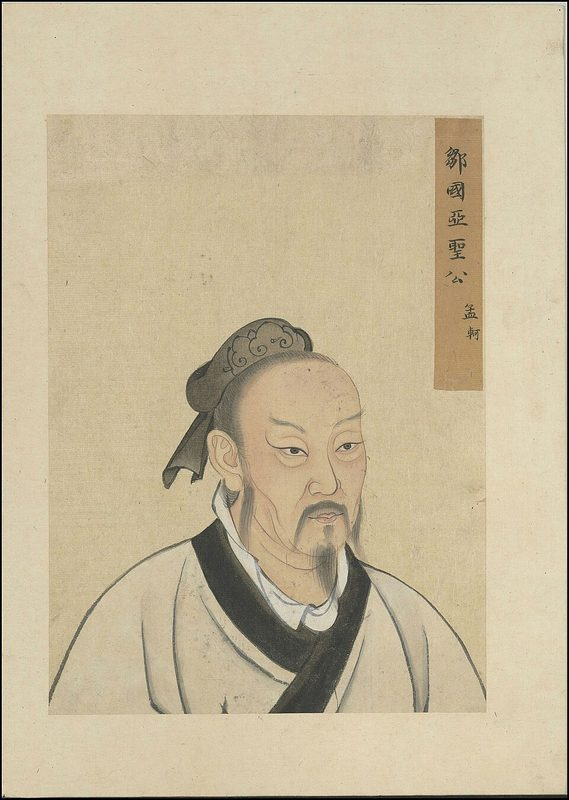
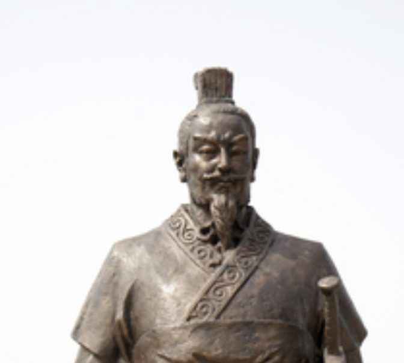
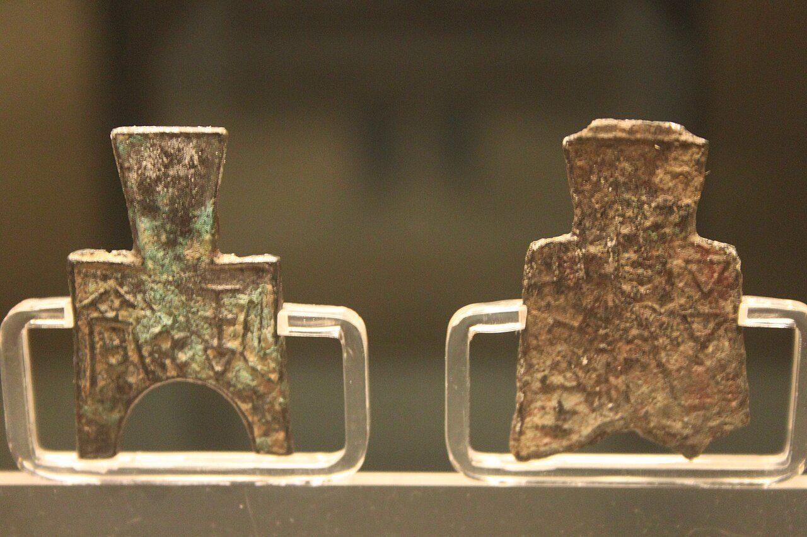
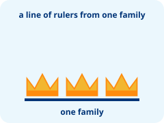
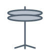
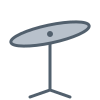
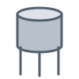

## How this deck is made {#how}

:::: {.columns}
::: {.column width="55%"}
- Optional: words in two languages, written once: `[Schools | 诸子]{.bi}` (next slide)
- Layout from Quarto and a few plain pieces: `.columns`, `.tiles`, `.chain`, `.box`, `.strip`
- What words *are*, not where they go: `.kicker`, `.big`, `.lead`, `.pill`, `.fine`
- A new look is a few lines of CSS (see `slide-kit-looks.css`)
:::
::: {.column width="45%"}
::: {.box .plain}
### Try it

The **palette** in the top-right corner tries other colours and looks, on this slide or on every slide.
:::
:::
::::

::: notes
Compare with the first experiment (slide-style-slides.qmd): there, each kind of slide had its own fixed slots. Here every slide is ordinary Markdown with a few classes, so a teacher can change the number of boxes, mix pieces, or add a picture without new code. Each slide's notes say which pieces it uses.
:::

## [This slide is bilingual | 这张幻灯片是双语的]{.bi} {#bilingual}

:::: {.columns}
::: {.column width="52%"}
::: {.box .plain}
[Optional · 可选]{.kicker}

[Any slide can have two languages. On English-only slides, the controls hide. | 任何幻灯片都可以使用两种语言。只有英文的幻灯片上，按钮会隐藏。]{.bi}
:::

::: box
[How to write it · 写法]{.kicker}

`[Schools | 诸子]{.bi}`

[English, a bar, then 中文. | 先写英文，再写竖线，然后写中文。]{.bi}
:::
:::
::: {.column width="48%"}
::: {.box .dark}
[The controls ↗ · 切换按钮]{.kicker}

- **EN** · [English only | 只显示英文]{.bi}
- **文A** · [both languages | 两种语言]{.bi}
- **中** · [中文 only | 只显示中文]{.bi}
- **⇅** · [swap the large one | 交换大小]{.bi}

[Your choice is kept for every deck in this browser. | 你的选择会保存在这个浏览器里，所有幻灯片都适用。]{.bi .fine style="color: inherit; opacity: 0.8"}
:::
:::
::::

::: notes
Bilingual slides are optional. Write `[English | 中文]{.bi}` anywhere: a title, a bullet, a box, a table cell (there, write the bar as `\|`). The deck's labels say which language is large at first (`bilingual: primary: en`). The controls show only on slides with bilingual text. Try them here: the orange box around them is only on this slide (`slide-kit-looks.css`). The rest of the deck shows bilingual text in many layouts (section opener, big idea, source, cards, task, table, media, frames, lesson intro, Think-Pair-Share, jigsaw) and some English-only slides.
:::

## {#section .center}

::: cover
[Part 2 · Spring and Autumn & Warring States | 第 2 节 · 春秋战国]{.bi .kicker}

[The Hundred Schools of Thought | 百家争鸣]{.bi .big}

::: tiles
::: {.box .plain}
::: row
[1]{.num}

[Why it happened | 争鸣原因]{.bi}
:::
:::

::: {.box .plain}
::: row
[2]{.num}

[The ideas | 治国主张]{.bi}
:::
:::

::: {.box .plain}
::: row
[3]{.num}

[The debate | 智慧对决]{.bi}
:::
:::
:::
:::

::: notes
A section opener. Pieces: `.cover` (fills the slide and centres it), `.kicker`, `.big`, `.tiles` of `.box .plain`, each a `.row` with a `.num`. Three agenda boxes or five: the tiles make as many columns as there are boxes.
:::

## [What defined the Warring States era? | 春秋战国有什么整体的时代特征？]{.bi} {#big-idea}

::: {.cover style="height: auto; padding: 0.6em 0"}
[Turmoil · Change · Growth | 动荡 · 变化 · 发展]{.bi .big style="text-align: center"}
:::

::: chain
::: {.box .plain style="text-align: center"}
[Economic change | 经济之变]{.bi}
:::

::: {.box .plain style="text-align: center"}
[Social change | 社会之变]{.bi}
:::

::: {.box .plain style="text-align: center"}
[A debate of ideas | 思想之辩]{.bi}
:::
:::

[The pre-Qin thinkers all wanted to save a troubled world, so their ideas grew out of their time. (Hu Shih) | 先秦诸子皆为忧世之乱而思以拯济之，故其学皆应时而生。——胡适]{.bi .fine}

::: notes
A big idea. Pieces: `.big` for the claim, `.chain` (tiles with arrows between them) for the three changes, `.fine` for the source. The question is the slide title, written once in both languages.
:::

## [Confucius · on government | 孔子 · 政治主张]{.bi} {#source}

::: {.box .plain}
::: row
[Source · 原文]{.kicker}

[Analects 2.1 · 《论语·为政》]{.fine}
:::

[The Master said: "Govern by virtue, and you are like the North Star. It stays in its place, and all the other stars turn toward it." | 子曰：“为政以德，譬如北辰，居其所而众星共之。”]{.bi .lead}
:::

:::: {.columns}
::: {.column width="62%"}
::: box
[Meaning · 解读]{.kicker}

[If a ruler leads by being good, people will follow him, like stars around the North Star. | 统治者如果用道德来治理国家，百姓就会像群星环绕北极星一样围绕着他。]{.bi}
:::
:::
::: {.column width="38%"}
::: {.box .dark}
[Takeaway · 要点]{.kicker}

[Rule by virtue | 为政以德]{.bi .big style="font-size: var(--step-3)"}
:::
:::
::::

::: notes
Source, meaning, takeaway. Pieces: three `.box`es (`.plain`, plain `.box`, `.dark`), each with a `.kicker` label; Quarto's own `.columns` for the 62/38 split. Each part has its own box, so long text never runs into the next part.
:::

## [Warring States thinkers · five schools | 战国诸子 · 五大学派]{.bi} {#cards}

::: tiles
::: box
{fig-alt="Mencius" style="--pic-position: 50% 60%"}

### [Confucianism | 儒家]{.bi}
[Mencius | 孟子]{.bi .muted}

**[Kind government | 仁政]{.bi}**

[《孟子》]{.bi .fine .end}
:::

::: box
{fig-alt="The book Mozi" style="--pic-position: 50% 30%"}

### [Mohism | 墨家]{.bi}
[Mozi | 墨子]{.bi .muted}

**[Love everyone, no wars of attack | 兼爱非攻]{.bi}**

[《墨子》]{.bi .fine .end}
:::

::: box
{fig-alt="Zhuangzi" style="--pic-position: 50% 20%"}

### [Daoism | 道家]{.bi}
[Zhuangzi | 庄子]{.bi .muted}

**[Follow nature | 顺应自然]{.bi}**

[《庄子》]{.bi .fine .end}
:::

::: {.box .spot}
{fig-alt="A statue of Han Fei" style="--pic-position: 50% 25%"}

### [Legalism | 法家]{.bi}
[Han Fei | 韩非]{.bi .muted}

**[Rule by law, a strong ruler | 以法治国]{.bi}**

[《韩非子》]{.bi .fine .end}
:::

::: box
{fig-alt="Sun Bin" style="--pic-position: 50% 60%"}

### [Military thinkers | 兵家]{.bi}
[Wu Qi, Sun Bin | 吴起 孙膑]{.bi .muted}

**[Military strategy | 军事战略]{.bi}**

[《孙膑兵法》]{.bi .fine .end}
:::
:::

::: strip
[Think · 思考]{.pill}

[Which school's ideas did Warring States rulers like best? | 哪一个学派的主张最受战国统治者欢迎？]{.bi}
:::

::: notes
Cards. Pieces: `.tiles` of `.box` (five boxes make five columns; delete one and you get four), a `###` title in each, `.muted` and `.fine` for the quieter lines, `.end` to push the book title to the bottom, `.spot` on the one to discuss, and a `.strip` with a `.pill` for the question. The next three slides are this slide again, with one class on the title.
:::

## [Warring States thinkers · five schools | 战国诸子 · 五大学派]{.bi} {#cards-game .look-game}

::: tiles
::: box
{fig-alt="Mencius" style="--pic-position: 50% 60%"}

### [Confucianism | 儒家]{.bi}
[Mencius | 孟子]{.bi .muted}

**[Kind government | 仁政]{.bi}**

[《孟子》]{.bi .fine .end}
:::

::: box
{fig-alt="The book Mozi" style="--pic-position: 50% 30%"}

### [Mohism | 墨家]{.bi}
[Mozi | 墨子]{.bi .muted}

**[Love everyone, no wars of attack | 兼爱非攻]{.bi}**

[《墨子》]{.bi .fine .end}
:::

::: box
{fig-alt="Zhuangzi" style="--pic-position: 50% 20%"}

### [Daoism | 道家]{.bi}
[Zhuangzi | 庄子]{.bi .muted}

**[Follow nature | 顺应自然]{.bi}**

[《庄子》]{.bi .fine .end}
:::

::: {.box .spot}
{fig-alt="A statue of Han Fei" style="--pic-position: 50% 25%"}

### [Legalism | 法家]{.bi}
[Han Fei | 韩非]{.bi .muted}

**[Rule by law, a strong ruler | 以法治国]{.bi}**

[《韩非子》]{.bi .fine .end}
:::

::: box
{fig-alt="Sun Bin" style="--pic-position: 50% 60%"}

### [Military thinkers | 兵家]{.bi}
[Wu Qi, Sun Bin | 吴起 孙膑]{.bi .muted}

**[Military strategy | 军事战略]{.bi}**

[《孙膑兵法》]{.bi .fine .end}
:::
:::

::: strip
[Think · 思考]{.pill}

[Which school's ideas did Warring States rulers like best? | 哪一个学派的主张最受战国统治者欢迎？]{.bi}
:::

::: notes
The same slide with `{.look-game}` on its title: thick outlines, hard shadows, tilted cards. All of it is in `slide-kit-looks.css` (about ten lines).
:::

## [Warring States thinkers · five schools | 战国诸子 · 五大学派]{.bi} {#cards-brutal .look-brutal}

::: tiles
::: box
{fig-alt="Mencius" style="--pic-position: 50% 60%"}

### [Confucianism | 儒家]{.bi}
[Mencius | 孟子]{.bi .muted}

**[Kind government | 仁政]{.bi}**

[《孟子》]{.bi .fine .end}
:::

::: box
{fig-alt="The book Mozi" style="--pic-position: 50% 30%"}

### [Mohism | 墨家]{.bi}
[Mozi | 墨子]{.bi .muted}

**[Love everyone, no wars of attack | 兼爱非攻]{.bi}**

[《墨子》]{.bi .fine .end}
:::

::: box
{fig-alt="Zhuangzi" style="--pic-position: 50% 20%"}

### [Daoism | 道家]{.bi}
[Zhuangzi | 庄子]{.bi .muted}

**[Follow nature | 顺应自然]{.bi}**

[《庄子》]{.bi .fine .end}
:::

::: {.box .spot}
{fig-alt="A statue of Han Fei" style="--pic-position: 50% 25%"}

### [Legalism | 法家]{.bi}
[Han Fei | 韩非]{.bi .muted}

**[Rule by law, a strong ruler | 以法治国]{.bi}**

[《韩非子》]{.bi .fine .end}
:::

::: box
{fig-alt="Sun Bin" style="--pic-position: 50% 60%"}

### [Military thinkers | 兵家]{.bi}
[Wu Qi, Sun Bin | 吴起 孙膑]{.bi .muted}

**[Military strategy | 军事战略]{.bi}**

[《孙膑兵法》]{.bi .fine .end}
:::
:::

::: strip
[Think · 思考]{.pill}

[Which school's ideas did Warring States rulers like best? | 哪一个学派的主张最受战国统治者欢迎？]{.bi}
:::

::: notes
`{.look-brutal}`: square corners, heavy borders, offset shadows, a highlighted title.
:::

## [Warring States thinkers · five schools | 战国诸子 · 五大学派]{.bi} {#cards-scroll .look-scroll}

::: tiles
::: box
{fig-alt="Mencius" style="--pic-position: 50% 60%"}

### [Confucianism | 儒家]{.bi}
[Mencius | 孟子]{.bi .muted}

**[Kind government | 仁政]{.bi}**

[《孟子》]{.bi .fine .end}
:::

::: box
{fig-alt="The book Mozi" style="--pic-position: 50% 30%"}

### [Mohism | 墨家]{.bi}
[Mozi | 墨子]{.bi .muted}

**[Love everyone, no wars of attack | 兼爱非攻]{.bi}**

[《墨子》]{.bi .fine .end}
:::

::: box
{fig-alt="Zhuangzi" style="--pic-position: 50% 20%"}

### [Daoism | 道家]{.bi}
[Zhuangzi | 庄子]{.bi .muted}

**[Follow nature | 顺应自然]{.bi}**

[《庄子》]{.bi .fine .end}
:::

::: {.box .spot}
{fig-alt="A statue of Han Fei" style="--pic-position: 50% 25%"}

### [Legalism | 法家]{.bi}
[Han Fei | 韩非]{.bi .muted}

**[Rule by law, a strong ruler | 以法治国]{.bi}**

[《韩非子》]{.bi .fine .end}
:::

::: box
{fig-alt="Sun Bin" style="--pic-position: 50% 60%"}

### [Military thinkers | 兵家]{.bi}
[Wu Qi, Sun Bin | 吴起 孙膑]{.bi .muted}

**[Military strategy | 军事战略]{.bi}**

[《孙膑兵法》]{.bi .fine .end}
:::
:::

::: strip
[Think · 思考]{.pill}

[Which school's ideas did Warring States rulers like best? | 哪一个学派的主张最受战国统治者欢迎？]{.bi}
:::

::: notes
`{.look-scroll}`: a hanging scroll, all in `slide-kit-looks.css`: paper with fibres, a red frame with cloud-curl corners, a brush stroke under the title, a seal (`--seal: "学"`), cards hung from wooden rods, and a serif font for 中文 (`--bi-zh-font`).
:::

## [Group task · prepare your statement | 小组任务 · 准备发言]{.bi} {#task}

:::: {.columns}
::: {.column width="64%"}
::: steps
1. [Each person chooses one thinker | 每人选择一个思想家]{.bi}
2. [Sit with others from your school | 同一学派的同学坐在一起]{.bi}
3. [Use the frames: problem, solution, reason | 用句型准备：问题、方案、原因]{.bi}
:::

::: {.box .plain}
[Done when · 完成标准]{.kicker}

[Every member can say one idea and one reason from their school. | 每位成员都能说出本学派的一个主张和一个理由。]{.bi}
:::
:::
::: {.column width="36%"}
::: {.box .dark style="align-items: center"}
[Timer · 计时]{.kicker}


:::

::: {.box .plain}
[Materials · 材料]{.kicker}

[Worksheet, parts 1 and 2 | 学习单 第 1–2 部分]{.bi}

[Hand in parts 1 and 2. | 上交第 1–2 部分。]{.bi .fine}
:::
:::
::::

::: notes
A task. Pieces: Chalkline's existing `.steps` (numbered cards), `.box` with `.kicker` labels, the `` shortcode inside a `.dark` box, Quarto `.columns`.
:::

## [Why did the Hundred Schools appear? | 为什么会出现百家争鸣？]{.bi} {#reveal-table}

| | |
|:--|:--|
| [Politics \| 政治]{.bi} | [[The old order fell apart. No one idea was in charge. \| 礼崩乐坏，诸侯争霸，没有一种学说取得独尊地位。]{.bi}]{.fragment} |
| [Economy \| 经济]{.bi} | [[Iron tools and ox plows made more food, enough to feed scholars. \| 铁器和牛耕推广，农业发展，能够供养知识分子。]{.bi}]{.fragment} |
| [Science \| 科技]{.bi} | [[New tools and new knowledge spread. \| 新的工具和知识不断传播。]{.bi}]{.fragment} |
| [Education \| 教育]{.bi} | [[Schools opened to more people, not only nobles. \| 私学兴起，教育不再只属于贵族。]{.bi}]{.fragment} |

: {tbl-colwidths="[24,76]"}

::: notes
A reveal table: an ordinary Markdown table (inside a table cell the bar is written `\|`); each answer is a `.fragment`, so it appears on the next click. The row labels always show. The table's look is Chalkline's existing table style.
:::

## {#media background-color="#14213D"}

[Look · 观察]{.pill .absolute top=10 left=0}

::: {.cover .media}
{fig-alt="Two bronze coins shaped like small spades"}

::: {.box .plain}
::: row
[Think · 思考]{.kicker}

[These are coins. Why are they shaped like spades? | 这些是钱币。它们为什么是铲子的形状？]{.bi .lead}
:::

[Spade coins, Warring States, Shanghai Museum. Photo: Gary Lee Todd, CC0. | 战国布币，上海博物馆。]{.bi .fine}
:::
:::

::: notes
Media. The picture is in the slide, not behind it, inside a `.cover .media` block: it grows to fill the room the caption box leaves, so the question never covers it. A video works the same way: `` with no size fills the room left on its slide. A `.pill` is pinned to the corner with Quarto's `.absolute`.
:::

## [Speaking frames: fill in the blanks | 发言句型]{.bi} {#frames}

::: {.tiles style="--cols: 1; --gap: 0.3em"}
::: {.box .plain}
::: row
[1]{.num}

[What is the problem? | 问题是什么？]{.bi .small style="width: 9em"}

[The main problem is [ ]{.gap}. | 我们时代最大的困境是[ ]{.gap}。]{.bi}
:::
:::

::: {.box .plain}
::: row
[2]{.num}

[What is the solution? | 解决方案是什么？]{.bi .small style="width: 9em"}

[Our school believes the best way is [ ]{.gap}. | 我们学派认为最好的办法是[ ]{.gap}。]{.bi}
:::
:::

::: {.box .plain}
::: row
[3]{.num}

[Why does it work? | 为什么这样做？]{.bi .small style="width: 9em"}

[This idea works because [ ]{.gap}. | 这样做的原因是[ ]{.gap}。]{.bi}
:::
:::

::: {.box .plain}
::: row
[4]{.num}

[What will happen? | 期望结果是什么？]{.bi .small style="width: 9em"}

[If rulers follow our idea, [ ]{.gap} will happen. | 如果君主采纳我们的思想，[ ]{.gap}将会发生。]{.bi}
:::
:::
:::

::: notes
Sentence frames. Pieces: `.tiles` with one column (`style="--cols: 1"`), each frame a `.box .plain` holding a `.row`: a `.num`, the question (`.small`) and the frame, with `[ ]{.gap}` for each blank.
:::

## {#lesson-intro data-menu-title="Do now · 课前任务"}

:::: {.columns style="height: 700px"}
::: {.column width="57%"}
::: {.area .content label="Content objective · 内容目标"}
::: lesson-info
| | |
|--:|:--|
| [History \| 历史]{.bi} | [Grade 7 · [today]{.today} \| 七年级 · [今天]{.today}]{.bi} |
| [Topic \| 课题]{.bi} | [The Hundred Schools of Thought \| 百家争鸣]{.bi} |
| [Objective \| 学习目标]{.bi} | [I can explain one school's big idea. \| 我能说出一个学派的主张。]{.bi} |
| [Homework \| 作业]{.bi} | [Museum card, due Friday \| 博物馆卡片，周五交]{.bi} |

: {tbl-colwidths="[25,75]"}
:::
:::

::: {.area .language label="Language objective · 语言目标"}
[Vocab · 词汇]{.pill .tag}

::: {.tiles .vocab-row style="--pic-fit: contain; --pic-height: 2.6em"}
::: {.box .plain}
{fig-alt=""}


:::

::: {.box .plain}
{fig-alt=""}


:::

::: {.box .plain}
{fig-alt=""}


:::

::: {.box .plain}
{fig-alt=""}


:::
:::

[Sentence frames · 句型]{.pill .tag}

[The [ ]{.gap} school said rulers should [ ]{.gap}. | [ ]{.gap}学派认为统治者应该[ ]{.gap}。]{.bi .frame}
:::
:::
::: {.column width="43%"}
::: {.area .donow label="Do now · 课前任务"}
1. [Name one thinker from the last lesson. | 说出上节课学过的一位思想家。]{.bi}
2. [What was his big idea? Write one sentence. | 他的主要主张是什么？写一句话。]{.bi}

::: {.end style="align-self: center; font-size: 0.48em"}

:::
:::
:::
::::

```{=html}
<script>
  // Today's date in the title: "29 October" in English, "10月29日" in 中文 (the visitor's own clock)
  document.querySelectorAll("#lesson-intro .today").forEach(function (el) {
    var d = new Date();
    el.textContent = el.closest(".bil-zh") ? (d.getMonth() + 1) + "月" + d.getDate() + "日"
      : d.toLocaleDateString("en-GB", { day: "numeric", month: "long" });
  });
</script>
```

::: notes
Lesson intro and Do now, on one slide. Pieces: no slide title (`## {#lesson-intro data-menu-title="Do now"}`: the menu (☰) still lists it by that name), so the Do now runs the slide's full height; the subject, grade and today's date are the first row of the content table, in its colour (the date is filled in when the slide opens: `[today]{.today}` and a few lines of script on the slide); two `.area` blocks, each labelled in its corner (`label="Content objective"`, `label="Language objective"`) so observers find them at once: the content area holds an ordinary Markdown table for topic, objective and homework, in a `.lesson-info` block that right-aligns the labels against a line; the language area holds two `.pill` tags, Vocab and Sentence frames, each followed by its content: `.tiles` of `.box` for the words, each with its picture first (`--pic-fit: contain` shows a whole drawing) and the word as `` (a pop-up with picture and 中文); and a sentence frame with `[ ]{.gap}` for the blanks (all in `slide-kit-looks.css`); an `.area` for the Do now, labelled like the objectives and as tall as the slide, with `` pushed to its bottom with `.end`.
:::

## Make a museum card {#instructions}

:::: {.columns}
::: {.column width="56%"}


::: {.box .plain style="font-size: 0.85em"}
[Instructions]{.kicker}

Watch how ink is made. Then make a card for one thinker.

1. Write his name, school and big idea.
2. Draw one picture for his idea.
:::
:::
::: {.column width="44%"}
[Work gallery]{.kicker}


:::
::::

::: notes
Instructions, a video and a work gallery. Pieces: Quarto `.columns`; `` (here a CC0 video on Wikimedia Commons, so it needs the internet; a file in the deck's folder works too, and a YouTube or Vimeo link sizes itself); a `.box` with a `.kicker` and a numbered list; on the right Chalkline's packet gallery, ``: every page of a PDF as a thumbnail; tap one to open it large. It shows a unit packet (made by a full build) or any worksheet's PDF.
:::

## [Think · Pair · Share | 思考 · 结对 · 分享]{.bi} {#tps}

:::: {.columns}
::: {.column width="46%"}
::: {.box .plain style="font-size: 0.9em"}
- [**Listen** to the question. | **听**问题。]{.bi}
- [**Think** about your answer. | **想**一想你的答案。]{.bi}
- [**Talk** to your partner (2×). | 和同伴**说**（两次）。]{.bi}
- [**Share** with the whole class. | 和全班**分享**。]{.bi}
:::

::: {.tiles style="--pic-fit: contain; --pic-height: 3.6em; text-align: center"}
::: {.box .plain}
{fig-alt="Two students sitting side by side"}

[1 · Knee to knee | 膝对膝]{.bi}
:::

::: {.box .plain}
{fig-alt="Two students facing each other at a table"}

[2 · Face to face | 面对面]{.bi}
:::

::: {.box .plain}
{fig-alt="A teacher and the whole class"}

[3 · Whole class | 全班]{.bi}
:::
:::
:::
::: {.column width="54%"}
::: {.box style="--pic-height: 4.2em; --pic-fit: contain"}
{fig-alt="Map of the seven Warring States around 260 BCE"}

[Ask · 提问]{.kicker}

[Which state is the biggest? | 哪个国家最大？]{.bi}

[Why might the other six states join together? | 其他六国为什么可能联合起来？]{.bi}
:::

::: {.tiles style="font-size: 0.45em"}
::: {.box .dark style="align-items: center"}
[Think · 思考]{.kicker}


:::

::: {.box .dark style="align-items: center"}
[Share ×2 · 分享 ×2]{.kicker}


:::
:::
:::
::::

::: notes
Think-Pair-Share. Pieces: a `.box` with the four steps; `.tiles` of three boxes for where students sit (original drawings, shown whole with `--pic-fit: contain`); on the right a `.box` with the question and a picture, and two `.dark` boxes with `` and `` (a slide can have more than one timer; `font-size: 0.45em` on their tiles makes them smaller).
:::

## Drum kit: easy to hard {#easy-to-hard}

:::: {.columns style="font-size: 0.8em"}
::: column
### Part 1: two events per sprite

::: row
[1]{.num}

{.thumb fig-alt="A bass drum" style="object-fit: contain"}

**Bass drum:** a loud low sound + smaller and bigger.
:::

::: row
[2]{.num}

{.thumb fig-alt="A hi-hat" style="object-fit: contain"}

**Hi-hat:** a high crash sound + smaller and bigger.
:::

::: row
[3]{.num}

{.thumb fig-alt="A ride cymbal" style="object-fit: contain"}

**Ride cymbal:** a medium crash sound + shake left and right.
:::

::: row
[4]{.num}

{.thumb fig-alt="Two stars" style="object-fit: contain"}

**Stars:** appear and disappear, turn forever (opposite ways!).
:::
:::
::: column
### Part 2: three events per sprite

::: row
[5]{.num}

{.thumb fig-alt="A snare drum" style="object-fit: contain"}

**Snare drum:** a sound + smaller and bigger + a fast jump.
:::

::: row
[6]{.num}

{.thumb fig-alt="A tom drum" style="object-fit: contain"}

**Tom:** a sound + smaller and bigger + fast up and down.
:::

::: row
[7]{.num}

{.thumb fig-alt="A floor tom" style="object-fit: contain"}

**Floor tom:** the same sprite and code as the tom. Just add legs!
:::

::: row
[8]{.num}

{.thumb fig-alt="A dancing cat" style="object-fit: contain"}

**Dancing character:** dances forever, says "hee hee!", and gets bigger and smaller when touched. (Not only a cat!)
:::
:::
::::

::: notes
Chained instructions, easy to hard: each challenge adds to the same project (a drum kit made of sprites), so students build it up step by step and go as far as they can. Pieces: Quarto `.columns` with a `###` heading for each part; each challenge a `.row` with a `.num`, a small `.thumb` picture (`object-fit: contain` shows a whole drawing) and its words.
:::

## [Jigsaw: expert groups | 拼图学习：专家组任务]{.bi} {#jigsaw}

:::: {.columns}
::: {.column width="31%"}
::: {style="font-size: 0.5em; --pic-fit: contain; --pic-height: 1.8em; --pad: 0.3em 0.7em; --gap: 0.25em"}
::: {.box .plain}
{fig-alt="Four home groups, each with one A, B, C and D"}

[1 · Home group | 原小组]{.bi .kicker}

[Get a letter: A, B, C or D. | 每人领一个字母。]{.bi}
:::

::: {.box .plain}
{fig-alt="Four expert groups: all A, all B, all C, all D"}

[2 · Expert group | 专家组]{.bi .kicker}

[Do your puzzle piece. Agree on 3 key points. | 完成你的拼图任务，总结3个要点。]{.bi}

::: {style="font-size: 0.42em; align-self: center"}

:::
:::

::: {.box .plain}
[3 · Back home: teach | 回原小组：讲解]{.bi .kicker}

[Teach your 3 points. Take notes. | 讲解3个要点，做笔记。]{.bi}

::: {style="font-size: 0.42em; align-self: center"}

:::
:::
:::
:::
::: {.column width="69%"}
::: puzzle
::: {.box style="--piece: #FFE4C7; --strong: #FF8C0F"}
::: row
[A]{.num}

{.thumb fig-alt="Mencius"}

[Confucianism · Mencius | 儒家 · 孟子]{.bi}
:::

[Read about Mencius. What should a good ruler do? | 阅读孟子。好的统治者应该做什么？]{.bi}
:::

::: {.box style="--piece: #CDF6F3; --strong: #14D7CD"}
::: row
[B]{.num}

{.thumb fig-alt="The book Mozi"}

[Mohism · Mozi | 墨家 · 墨子]{.bi}
:::

[Read about Mozi. Why was he against wars of attack? | 阅读墨子。他为什么反对攻打别国？]{.bi}
:::

::: {.box style="--piece: #D3E8FF; --strong: #0087FF"}
::: row
[C]{.num}

{.thumb fig-alt="Zhuangzi"}

[Daoism · Zhuangzi | 道家 · 庄子]{.bi}
:::

[Read about Zhuangzi. What does "follow nature" mean? | 阅读庄子。“顺应自然”是什么意思？]{.bi}
:::

::: {.box style="--piece: #D5DEEB; --strong: #003477"}
::: row
[D]{.num}

{.thumb fig-alt="A statue of Han Fei"}

[Legalism · Han Fei | 法家 · 韩非]{.bi}
:::

[Read about Han Fei. Why did rulers like strict laws? | 阅读韩非。统治者为什么喜欢严格的法律？]{.bi}
:::
:::
:::
::::

::: notes
A jigsaw. Students start in mixed home groups and each takes a letter; the same letters meet as an expert group and do that puzzle piece; then everyone goes home and teaches it. Pieces: on the left, three `.box`es, the first two with a picture first (original drawings: each circle is a student, the letter is their topic), a `.kicker` and a `` for the two timed steps; on the right `::: puzzle`, four `.box`es that lock together like puzzle pieces (`slide-kit-looks.css`), each with its tint (`--piece`), a `.num` in its letter's colour (`--strong`), a `.thumb` picture and the group's question.
:::

## [Lesson summary | 课堂小结]{.bi} [made in draw.io]{.drawio-label} {#summary}

<link rel="stylesheet" href="drawio/drawio-live.css">
<div class="drawio-live" data-src="drawio/summary.svg"></div>
<script src="drawio/drawio-live.js"></script>

::: notes
A diagram made in draw.io: the source is `drawio/summary.drawio`. Open it in draw.io (the desktop app or app.diagrams.net), change it, save, then run `python chalkline.py drawio` to update the picture (`summary.svg`). On the slide, point at or tap a box: it lifts and the rest fades. The words in the diagram don't follow the language switch.
:::

## [What defined the Warring States era? | 春秋战国有什么整体的时代特征？]{.bi} {#big-idea-dusk .look-dusk background-color="#00234F"}

::: {.cover style="height: auto; padding: 0.6em 0"}
[Turmoil · Change · Growth | 动荡 · 变化 · 发展]{.bi .big style="text-align: center"}
:::

::: chain
::: {.box style="text-align: center"}
[Economic change | 经济之变]{.bi}
:::

::: {.box style="text-align: center"}
[Social change | 社会之变]{.bi}
:::

::: {.box style="text-align: center"}
[A debate of ideas | 思想之辩]{.bi}
:::
:::

[The pre-Qin thinkers all wanted to save a troubled world, so their ideas grew out of their time. (Hu Shih) | 先秦诸子皆为忧世之乱而思以拯济之，故其学皆应时而生。——胡适]{.bi .fine}

::: notes
The big idea again with `{.look-dusk}` and a dark `background-color=`. Nothing in the bilingual text changed: the second language is a lighter shade of whatever colour the text has, so it works on dark slides too.
:::

## Colour schemes {#schemes}

- Four schemes come with Chalkline, made from the brand colours: **night**, **sky**, **lagoon** and **sunrise**
- A course can add its own: this deck's **trail** is in `slide-kit-looks.css`
- One slide: `## Title {.scheme-night}`
- A whole deck: `slide-scheme: night` in its labels
- Chalkline's own pieces follow too: tables, steps, vocab cards, callouts

::: notes
The schemes are in `_extensions/chalkline/styles/schemes.scss`. Each one is only a list of tokens (about fifteen colours). Night comes from the Robotics League course's dark "Workshop Night" slides.
:::

## [Warring States thinkers · five schools | 战国诸子 · 五大学派]{.bi} {#cards-night .scheme-night}

::: tiles
::: box
{fig-alt="Mencius" style="--pic-position: 50% 60%"}

### [Confucianism | 儒家]{.bi}
[Mencius | 孟子]{.bi .muted}

**[Kind government | 仁政]{.bi}**

[《孟子》]{.bi .fine .end}
:::

::: box
{fig-alt="The book Mozi" style="--pic-position: 50% 30%"}

### [Mohism | 墨家]{.bi}
[Mozi | 墨子]{.bi .muted}

**[Love everyone, no wars of attack | 兼爱非攻]{.bi}**

[《墨子》]{.bi .fine .end}
:::

::: box
{fig-alt="Zhuangzi" style="--pic-position: 50% 20%"}

### [Daoism | 道家]{.bi}
[Zhuangzi | 庄子]{.bi .muted}

**[Follow nature | 顺应自然]{.bi}**

[《庄子》]{.bi .fine .end}
:::

::: {.box .spot}
{fig-alt="A statue of Han Fei" style="--pic-position: 50% 25%"}

### [Legalism | 法家]{.bi}
[Han Fei | 韩非]{.bi .muted}

**[Rule by law, a strong ruler | 以法治国]{.bi}**

[《韩非子》]{.bi .fine .end}
:::

::: box
{fig-alt="Sun Bin" style="--pic-position: 50% 60%"}

### [Military thinkers | 兵家]{.bi}
[Wu Qi, Sun Bin | 吴起 孙膑]{.bi .muted}

**[Military strategy | 军事战略]{.bi}**

[《孙膑兵法》]{.bi .fine .end}
:::
:::

::: strip
[Think · 思考]{.pill}

[Which school's ideas did Warring States rulers like best? | 哪一个学派的主张最受战国统治者欢迎？]{.bi}
:::

::: notes
`{.scheme-night}`: the cards slide, unchanged except for that class.
:::

## [Why did the Hundred Schools appear? | 为什么会出现百家争鸣？]{.bi} {#table-night .scheme-night}

| | |
|:--|:--|
| [Politics \| 政治]{.bi} | [[The old order fell apart. No one idea was in charge. \| 礼崩乐坏，诸侯争霸，没有一种学说取得独尊地位。]{.bi}]{.fragment} |
| [Economy \| 经济]{.bi} | [[Iron tools and ox plows made more food, enough to feed scholars. \| 铁器和牛耕推广，农业发展，能够供养知识分子。]{.bi}]{.fragment} |
| [Science \| 科技]{.bi} | [[New tools and new knowledge spread. \| 新的工具和知识不断传播。]{.bi}]{.fragment} |
| [Education \| 教育]{.bi} | [[Schools opened to more people, not only nobles. \| 私学兴起，教育不再只属于贵族。]{.bi}]{.fragment} |

: {tbl-colwidths="[24,76]"}

::: notes
Night on Chalkline's table style: the header row and stripes follow the scheme's tokens.
:::

## [Group task · prepare your statement | 小组任务 · 准备发言]{.bi} {#task-sky .scheme-sky}

:::: {.columns}
::: {.column width="64%"}
::: steps
1. [Each person chooses one thinker | 每人选择一个思想家]{.bi}
2. [Sit with others from your school | 同一学派的同学坐在一起]{.bi}
3. [Use the frames: problem, solution, reason | 用句型准备：问题、方案、原因]{.bi}
:::

::: {.box .plain}
[Done when · 完成标准]{.kicker}

[Every member can say one idea and one reason from their school. | 每位成员都能说出本学派的一个主张和一个理由。]{.bi}
:::
:::
::: {.column width="36%"}
::: {.box .dark style="align-items: center"}
[Timer · 计时]{.kicker}


:::

::: {.box .plain}
[Materials · 材料]{.kicker}

[Worksheet, parts 1 and 2 | 学习单 第 1–2 部分]{.bi}
:::
:::
::::

::: notes
`{.scheme-sky}`: the pale brand blue as the slide, white boxes.
:::

## {#section-lagoon .center .scheme-lagoon}

::: cover
[Part 2 · Spring and Autumn & Warring States | 第 2 节 · 春秋战国]{.bi .kicker}

[The Hundred Schools of Thought | 百家争鸣]{.bi .big}

::: tiles
::: {.box .plain}
::: row
[1]{.num}

[Why it happened | 争鸣原因]{.bi}
:::
:::

::: {.box .plain}
::: row
[2]{.num}

[The ideas | 治国主张]{.bi}
:::
:::

::: {.box .plain}
::: row
[3]{.num}

[The debate | 智慧对决]{.bi}
:::
:::
:::
:::

::: notes
`{.scheme-lagoon}`: turquoise slide, navy text. Loud: for openers and the one slide everyone should look at.
:::

## [Confucius · on government | 孔子 · 政治主张]{.bi} {#source-sunrise .scheme-sunrise}

::: {.box .plain}
::: row
[Source · 原文]{.kicker}

[Analects 2.1 · 《论语·为政》]{.fine}
:::

[The Master said: "Govern by virtue, and you are like the North Star. It stays in its place, and all the other stars turn toward it." | 子曰：“为政以德，譬如北辰，居其所而众星共之。”]{.bi .lead}
:::

:::: {.columns}
::: {.column width="62%"}
::: box
[Meaning · 解读]{.kicker}

[If a ruler leads by being good, people will follow him, like stars around the North Star. | 统治者如果用道德来治理国家，百姓就会像群星环绕北极星一样围绕着他。]{.bi}
:::
:::
::: {.column width="38%"}
::: {.box .dark}
[Takeaway · 要点]{.kicker}

[Rule by virtue | 为政以德]{.bi .big style="font-size: var(--step-3)"}
:::
:::
::::

::: notes
`{.scheme-sunrise}`: warm paper from the brand orange, turquoise as the highlight.
:::

## {#section-trail .center .scheme-trail}


::: cover
[Part 2 · Spring and Autumn & Warring States | 第 2 节 · 春秋战国]{.bi .kicker}

[The Hundred Schools of Thought | 百家争鸣]{.bi .big}

::: tiles
::: {.box .plain}
::: row
[1]{.num}

[Why it happened | 争鸣原因]{.bi}
:::
:::

::: {.box .plain}
::: row
[2]{.num}

[The ideas | 治国主张]{.bi}
:::
:::

::: {.box .plain}
::: row
[3]{.num}

[The debate | 智慧对决]{.bi}
:::
:::
:::
:::

::: notes
`{.scheme-trail}`: this deck's own scheme, made for fun after a handbag catalogue: cream paper, suede boxes with white stitching, olive line drawings and turquoise beads in the background, turquoise as the highlight. All of it is about 40 lines in `slide-kit-looks.css`; the background is one drawing (`--paper-image`).
:::

## [Warring States thinkers · five schools | 战国诸子 · 五大学派]{.bi} {#cards-trail .scheme-trail}


::: tiles
::: box
{fig-alt="Mencius" style="--pic-position: 50% 60%"}

### [Confucianism | 儒家]{.bi}
[Mencius | 孟子]{.bi .muted}

**[Kind government | 仁政]{.bi}**

[《孟子》]{.bi .fine .end}
:::

::: box
{fig-alt="The book Mozi" style="--pic-position: 50% 30%"}

### [Mohism | 墨家]{.bi}
[Mozi | 墨子]{.bi .muted}

**[Love everyone, no wars of attack | 兼爱非攻]{.bi}**

[《墨子》]{.bi .fine .end}
:::

::: box
{fig-alt="Zhuangzi" style="--pic-position: 50% 20%"}

### [Daoism | 道家]{.bi}
[Zhuangzi | 庄子]{.bi .muted}

**[Follow nature | 顺应自然]{.bi}**

[《庄子》]{.bi .fine .end}
:::

::: {.box .spot}
{fig-alt="A statue of Han Fei" style="--pic-position: 50% 25%"}

### [Legalism | 法家]{.bi}
[Han Fei | 韩非]{.bi .muted}

**[Rule by law, a strong ruler | 以法治国]{.bi}**

[《韩非子》]{.bi .fine .end}
:::

::: box
{fig-alt="Sun Bin" style="--pic-position: 50% 60%"}

### [Military thinkers | 兵家]{.bi}
[Wu Qi, Sun Bin | 吴起 孙膑]{.bi .muted}

**[Military strategy | 军事战略]{.bi}**

[《孙膑兵法》]{.bi .fine .end}
:::
:::

::: strip
[Think · 思考]{.pill}

[Which school's ideas did Warring States rulers like best? | 哪一个学派的主张最受战国统治者欢迎？]{.bi}
:::

::: notes
The cards in trail: a stitched ring on each card, a turquoise stitched border on the highlighted one, a zigzag under the title.
:::

## [What defined the Warring States era? | 春秋战国有什么整体的时代特征？]{.bi} {#big-idea-glass .scheme-glass}


::: {.cover style="height: auto; padding: 0.6em 0"}
[Turmoil · Change · Growth | 动荡 · 变化 · 发展]{.bi .big style="text-align: center"}
:::

::: chain
::: {.box style="text-align: center"}
[Economic change | 经济之变]{.bi}
:::

::: {.box style="text-align: center"}
[Social change | 社会之变]{.bi}
:::

::: {.box style="text-align: center"}
[A debate of ideas | 思想之辩]{.bi}
:::
:::

[The pre-Qin thinkers all wanted to save a troubled world, so their ideas grew out of their time. (Hu Shih) | 先秦诸子皆为忧世之乱而思以拯济之，故其学皆应时而生。——胡适]{.bi .fine}

::: notes
`{.scheme-glass}`: flat and modern. A full-slide abstract picture with frosted, see-through tiles (`backdrop-filter`) on it. The picture is an original drawing; any photo can take its place (one line in `slide-kit-looks.css`).
:::

## [Warring States thinkers · five schools | 战国诸子 · 五大学派]{.bi} {#cards-glass .scheme-glass}


::: tiles
::: box
{fig-alt="Mencius" style="--pic-position: 50% 60%"}

### [Confucianism | 儒家]{.bi}
[Mencius | 孟子]{.bi .muted}

**[Kind government | 仁政]{.bi}**

[《孟子》]{.bi .fine .end}
:::

::: box
{fig-alt="The book Mozi" style="--pic-position: 50% 30%"}

### [Mohism | 墨家]{.bi}
[Mozi | 墨子]{.bi .muted}

**[Love everyone, no wars of attack | 兼爱非攻]{.bi}**

[《墨子》]{.bi .fine .end}
:::

::: box
{fig-alt="Zhuangzi" style="--pic-position: 50% 20%"}

### [Daoism | 道家]{.bi}
[Zhuangzi | 庄子]{.bi .muted}

**[Follow nature | 顺应自然]{.bi}**

[《庄子》]{.bi .fine .end}
:::

::: {.box .spot}
{fig-alt="A statue of Han Fei" style="--pic-position: 50% 25%"}

### [Legalism | 法家]{.bi}
[Han Fei | 韩非]{.bi .muted}

**[Rule by law, a strong ruler | 以法治国]{.bi}**

[《韩非子》]{.bi .fine .end}
:::

::: box
{fig-alt="Sun Bin" style="--pic-position: 50% 60%"}

### [Military thinkers | 兵家]{.bi}
[Wu Qi, Sun Bin | 吴起 孙膑]{.bi .muted}

**[Military strategy | 军事战略]{.bi}**

[《孙膑兵法》]{.bi .fine .end}
:::
:::

::: strip
[Think · 思考]{.pill}

[Which school's ideas did Warring States rulers like best? | 哪一个学派的主张最受战国统治者欢迎？]{.bi}
:::

::: notes
The cards in glass.
:::

## [Credits | 来源]{.bi} {#credits .credits}

:::: columns
::: column
### Pictures

- **Mencius:** album portrait, Yuan dynasty, National Palace Museum, Taipei. Public domain, via [Wikimedia Commons](https://commons.wikimedia.org/wiki/File:%E8%87%B3%E8%81%96%E5%85%88%E8%B3%A2%E5%8D%8A%E8%BA%AB%E5%83%8F_%E5%86%8A-005-%E5%AD%9F%E8%BB%BB.jpg).
- **Mozi:** a page of the book *Mozi*, old woodblock edition. Public domain, via [Wikimedia Commons](https://commons.wikimedia.org/wiki/File:Mozi.jpg).
- **Zhuangzi:** album portrait. Public domain, via [Wikimedia Commons](https://commons.wikimedia.org/wiki/File:Zhuangzi.png).
- **Han Fei:** statue in Shaanxi, photo by Sabinowitz, [CC BY-SA 4.0](https://creativecommons.org/licenses/by-sa/4.0/), via [Wikimedia Commons](https://commons.wikimedia.org/wiki/File:Statue_Of_Han_Fei.png).
- **Sun Bin:** Ming dynasty painting. Public domain, via [Wikimedia Commons](https://commons.wikimedia.org/wiki/File:Sun_Bin.jpg).
- **Spade coins:** Shanghai Museum, photo by Gary Lee Todd, CC0, via [Wikimedia Commons](https://commons.wikimedia.org/wiki/File:Warring_States_Spade_Coins.jpg).
- **Map of the Warring States:** Philg88, [CC BY-SA 3.0](https://creativecommons.org/licenses/by-sa/3.0/), via [Wikimedia Commons](https://commons.wikimedia.org/wiki/File:EN-WarringStatesAll260BCE.jpg).
:::

::: column
### Sources

- **Quoted:** *Analects* 2.1 (《论语·为政》). Classical text, public domain.
- **Named on the cards:** *Mencius* 《孟子》, *Mozi* 《墨子》, *Zhuangzi* 《庄子》, *Han Feizi* 《韩非子》, *Sun Bin's Art of War* 《孙膑兵法》.
- **Background:** [Hundred Schools of Thought](https://en.wikipedia.org/wiki/Hundred_Schools_of_Thought) and [Warring States period](https://en.wikipedia.org/wiki/Warring_States_period), Wikipedia, [CC BY-SA 4.0](https://creativecommons.org/licenses/by-sa/4.0/).
- **Video, grinding ink:** Wobuzowatsj, CC0, via [Wikimedia Commons](https://commons.wikimedia.org/wiki/File:Ink_grinding.webmhd.webm).
- **Original, made for this course:** the vocab, seating, drum kit and jigsaw drawings, the Lesson summary diagram, the glass scheme's background. Full list: `images/CREDITS.md`.
:::
::::

::: notes
Credits. Pieces: `{.credits}` on the title (small print), Quarto's `.columns` for pictures and sources. Every deck that uses outside pictures or sources ends with a slide like this one (see `CLAUDE.md`).
:::
