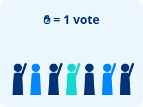
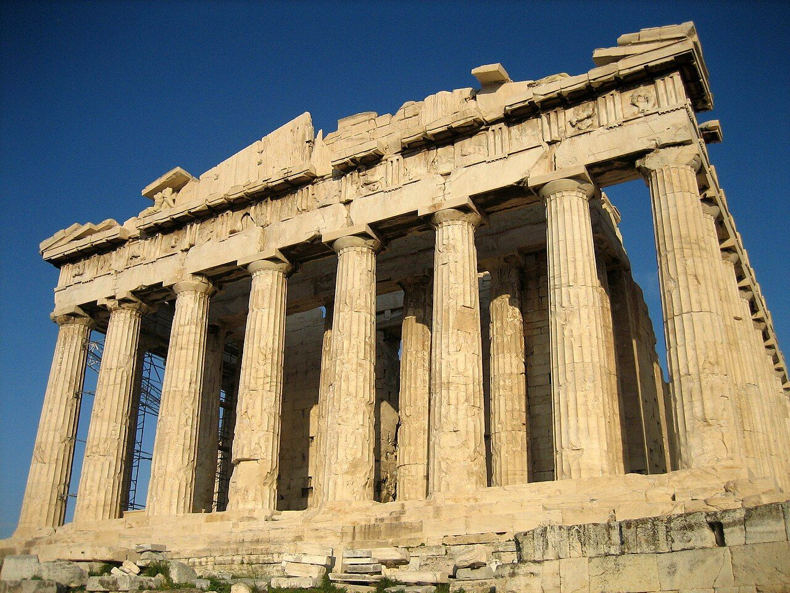
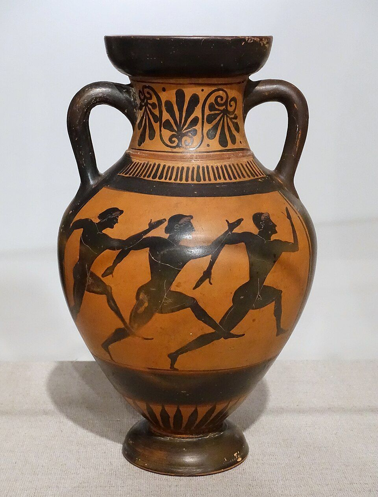

# Snowman ⛄

:::: {.columns .game-intro}
::: {.column width="38%"}
Guess the word, one letter at a time.

Every wrong letter melts part of the snowman!

Press **↓** to play.
:::
::: {.column width="62%"}
[Make your own]{.code-label}

```{.markdown code-line-numbers="false"}
A vocab word (the hint is its picture and meaning):


Your own word, hint and picture:


A random word from unit 1, with a New word button:

```
:::
::::

::: notes
Tap the letters on the board, or type them on the keyboard. **Hint** shows the picture and the meaning.

These slides go down (↓): a word, then a slide about it, then the next word. To do the same, start a column with a `#` heading and put each slide under it with `##`.
:::

## Word 1



## Democracy

:::: {.columns}
::: {.column width="55%"}
- : the people decide.
- In Athens,  met in the .
- They  on laws by raising their hands.
- Only free men born in Athens could vote.
:::
::: {.column width="45%"}
{fig-alt="Drawing of people raising their hands to vote"}
:::
::::

## Word 2



## The Parthenon

:::: {.columns}
::: {.column width="50%"}
- A  for **Athena**, the goddess of Athens.
- It stands on a hill called the **Acropolis**.
- The Greeks built it from white marble, from 447 to 432 BC.
- It has rows of tall .
:::
::: {.column width="50%"}
{.photo fig-alt="The Parthenon, a ruined marble temple with rows of columns, under a blue sky"}
:::
::::

## Word 3: a surprise!



::: notes
A random word from this unit. Press **New word** to play again with another word.
:::

# Picture reveal 🖼️

:::: {.columns .game-intro}
::: {.column width="38%"}
A picture is hiding under the tiles.

Open one tile at a time. Who can guess it first?

Press **↓** to play.
:::
::: {.column width="62%"}
[Make your own]{.code-label}

```{.markdown code-line-numbers="false"}
A vocab word's picture:


Your own picture, with 9 tiles:


A random picture from unit 1, with a New picture button:

```
:::
::::

::: notes
Fewer tiles opened = a better guess. Tap **Show the answer** when someone gets it. `tiles=9`, `16` (the usual) or `25`.
:::

## What is it?



## Which word is it?



# Jeopardy 🏆

:::: {.columns .game-intro}
::: {.column width="38%"}
Teams take turns. Choose a category and a number.

Bigger numbers are harder questions.

Press **↓** to play.
:::
::: {.column width="62%"}
[Make your own]{.code-label}

```{.markdown code-line-numbers="false"}
::: {.jeopardy teams="2"}
- **Places**
  - Land with water on three sides | a peninsula
  - This city had the first democracy | Athens
- **Gods**
  - The king of the gods | Zeus
  - The goddess of wisdom | Athena
:::

From unit 1's vocab, 3 teams, with a New board button:

```
:::
::::

::: notes
The team whose turn it is (filled in, with ▶) chooses a square. Read the clue, give the team time to answer, then tap **Show the answer** and mark it **✓ Right** (the team gets the points) or **✗ Wrong**. Either way the turn passes to the next team. The scores are under the board: tap a team's name to rename it, tap its score to change it, or tap the team anywhere else to give it the turn. − and + change the number of teams (2 to 4). When every square is used, the game shows the winner. `teams="0"` turns teams and scores off.

Each category is a **bold** line; under it, one line per clue: the clue, a `|`, then the answer. The first clue is worth 100, the next 200, and so on.
:::

## Ancient Greece

::: {.jeopardy}
- **Places**
  - Land with water on three sides | a peninsula
  - This city had the first democracy | Athens
  - Boys here left home at 7 to train as soldiers | Sparta
  - The Olympic Games were held here | Olympia
- **Gods**
  - The king of the gods | Zeus
  - The goddess of wisdom | Athena
  - The god of the sea | Poseidon
  - The gods lived on this mountain | Mount Olympus
- **Buildings**
  - A tall post that holds up a roof | a column
  - A building for a god or goddess | a temple
  - A famous temple in Athens | the Parthenon
  - An outdoor place for plays | a theater
- **Ideas**
  - People choose by raising their hands | vote
  - A story about gods and heroes | a myth
  - A thinker who asks big questions | a philosopher
  - Sports contests to honor Zeus | the Olympic Games
:::

## Vocab Jeopardy



# Quick-fire ⚡

:::: {.columns .game-intro}
::: {.column width="38%"}
A question pops up. Answer fast!

The teacher points to you. Say the answer out loud.

Press **↓** to play.
:::
::: {.column width="62%"}
[Make your own]{.code-label}

```{.markdown code-line-numbers="false"}
::: {.trivia title="Greece review" seconds="10"}
- Which city had the first democracy? | Athens
- The Olympic Games honored which god? | Zeus
:::

From unit 1's vocab, with a New questions button:

```
:::
::::

::: notes
Point to a student, let them answer, then tap **Show the answer** and mark it **✓ Right** or **✗ Wrong**. The game keeps the score.

One line per question: the question, a `|`, then the answer (one or two words is best). `seconds="0"` turns the timer off.
:::

## Greece review

::: {.trivia title="Ancient Greece review" seconds="10"}
- Which city had the first democracy? | Athens
- Greek stories about gods and heroes are called… | myths
- The Olympic Games honored which god? | Zeus
- Which city-state trained boys to be soldiers? | Sparta
- What is land with water on three sides? | a peninsula
:::

## Vocab quick-fire



# Matching 🔗

:::: {.columns .game-intro}
::: {.column width="38%"}
Tap a word. Then tap what it means.

A right pair stays. A wrong pair shakes!

Press **↓** to play.
:::
::: {.column width="62%"}
[Make your own]{.code-label}

```{.markdown code-line-numbers="false"}
::: {.matching}
- Zeus | The king of the gods
- Athena | The goddess of wisdom
:::

6 words from unit 1, with their meanings:


Words and their pictures:

```
:::
::::

::: notes
Tap a word on the left, then its partner on the right (or the other way round). A right pair locks in, in its own color; a wrong pair shakes. The game counts the tries. **Show the answers** matches everything.

Each line is a word, a `|`, then its partner. `count=8` gives more pairs (6 is the usual).
:::

## Greek gods

::: {.matching}
- Zeus | The king of the gods
- Athena | The goddess of wisdom
- Poseidon | The god of the sea
- Apollo | The god of music and the sun
- Ares | The god of war
- Hera | The queen of the gods
:::

## Words and pictures



# Memory 🃏

:::: {.columns .game-intro}
::: {.column width="38%"}
All the cards are face down.

Turn over two. Is it a word and its picture? Keep them!

Press **↓** to play.
:::
::: {.column width="62%"}
[Make your own]{.code-label}

```{.markdown code-line-numbers="false"}
6 words from unit 1 and their pictures:


Words and their meanings:


Your own pairs:
::: {.memory}
- Sparta | A city of soldiers
- Athens | The first democracy
:::
```
:::
::::

::: notes
Teams or students take turns: turn over two cards. If they are a pair, they stay face up; if not, they turn back over, so remember where they were! The game counts the turns. **Show all the cards** turns them all over.
:::

## Find the pairs



# Word scramble 🔤

:::: {.columns .game-intro}
::: {.column width="38%"}
The letters are mixed up.

Tap them in the right order to spell the word.

Press **↓** to play.
:::
::: {.column width="62%"}
[Make your own]{.code-label}

```{.markdown code-line-numbers="false"}
A vocab word:


Your own word and hint:


A random word from unit 1, with a New word button:

```
:::
::::

::: notes
Tap the letters, or type them on the keyboard. Tap a placed letter (or press Backspace) to take it back. **Mix again** shuffles the letters; **Hint** shows the picture and meaning.
:::

## Unscramble it



## A random word



# Sort it 🗂️

:::: {.columns .game-intro}
::: {.column width="38%"}
Which group does each word belong to?

Tap a word, then tap its group. Then press **Check**.

Press **↓** to play.
:::
::: {.column width="62%"}
[Make your own]{.code-label}

```{.markdown code-line-numbers="false"}
::: {.sort}
- **Athens**
  - Democracy | Athens let its citizens vote.
  - 
- **Sparta**
  - Two kings | Sparta had kings, not votes.
:::

Unit 1's vocab, by topic:

```
:::
::::

::: notes
Tap an item, then its group. A right item locks in green; a wrong one shakes, goes back to the bank, and its reason shows (what you wrote after the `|`). Each group is a **bold** line, with its items under it; any number of groups (2 to 4 fit best), so "Both" is just another group. An item can be a picture: ``. To let students sort everything first and check at the end, use `feedback="end"` (then **Check** marks each item and shows the reasons).

From the vocab list, words from one unit are sorted into their topics (geography, government, culture…); words from several units are sorted into their units.
:::

## Athens or Sparta?

::: {.sort}
- **Athens**
  - Democracy | Athens let its citizens vote on laws.
  - Plays and theater | Athens built theaters and wrote plays.
  - A strong navy | Athens was a sea power, with many warships.
  - Philosophers | Thinkers like Socrates lived in Athens.
- **Sparta**
  - Two kings | Sparta had two kings, not a democracy.
  - Boys trained as soldiers | In Sparta, boys left home at 7 to train for war.
  - The strongest army on land | Sparta's soldiers were the best in Greece.
  - Life built around the army | Everything in Sparta was about being ready for war.
:::

## Greek or Roman?

::: {.sort}
- **Ancient Greece**
  -  | The Parthenon is a Greek temple in Athens.
  -  | This theater is at Epidaurus, in Greece.
  -  | Greek vases often showed athletes, like these runners.
- **Ancient Rome**
  -  | The Colosseum is a huge arena in Rome.
  -  | Romans built aqueducts to carry water to cities.
  -  | The Via Appia is a Roman road, built for the army.
:::

## Sort the vocab



# Bingo 🎱

:::: {.columns .game-intro}
::: {.column width="38%"}
**Before class:** make the cards and print them.

**In class:** read the meanings. Cross out the word on your card.

A full line wins!
:::
::: {.column width="62%"}
[Make your own]{.code-label}

```{.markdown code-line-numbers="false"}
Bingo with unit 1's vocab:


Bingo with every word:

```

Or open **Review games** in the sidebar and choose **Bingo**.
:::
::::

::: notes
**1 · Make cards** (before class): choose the grid, the free square and the number of cards, then **Download the cards**: a PDF, two cards on each page, every card different. The **game code** printed on each card means you can check any card later, on any computer.

**2 · Call** (in class): **Next** shows a meaning (and its picture); students find the word and cross it out. When someone calls "Bingo!", type their card number and press **Check**: it shows the card with the called words, and whether it has a full line.
:::

## Ancient Greece bingo



# Word Blitz 🔥

:::: {.columns .game-intro}
::: {.column width="38%"}
See a picture. Choose the word.

Or see a word. Choose the picture.

Be quick! Faster answers get more points.

Right answers in a row multiply your points. Five in a row is **straight fire**! Ten is **cold fire**!

Press **↓** to play.
:::
::: {.column width="62%"}
[Make your own]{.code-label}

```{.markdown code-line-numbers="false"}
Unit 1's vocab (Classic or Survival):


Only pictures (choose the word),
15 seconds each:

```

Or open **Review games** in the sidebar and choose **Word Blitz**.
:::
::::

::: notes
Like Kahoot, for one player. Each question has four answers: three from this unit and one from another unit. A right answer scores 600 to 1,000 points (the faster, the more), times the **streak**: ×1.2 for two right in a row, ×1.3 for three, ×1.4 for four; then levels, each adding 2,000 points: **STRAIGHT FIRE** from 5 in a row (×1.5), **COLD FIRE** from 10 (×2, everything turns blue) and **SUPERNOVA** from 15 (×2.5, purple). A heat bar along the bottom grows toward the next level; at 4 in a row it shakes and the game turns orange, and from 5 a fire burns along the bottom. A wrong answer, or running out of time, ends the streak. Keys **1–4** choose an answer too.

Two modes, each with its own high scores: **Classic** (20 questions, or 10 if the whole course has fewer than 20 vocab words) and **Survival** (3 lives, and a life back at each new level, up to 3; the clock gets a second faster every 5 questions, down to 5 seconds). Every word is asked once before any comes back; a word comes back the other way round (picture or word), and a missed word comes back 3 questions later.

At the end, a player with a high score types their name. The high-score table is saved **only in this browser on this computer**, so one computer can be a station: students take turns, and the table shows the winner at the end of the lesson. **Clear the scores** (tap twice) starts a new table.

Options: `mode="survival"` (the mode it starts on), `count=20` (Classic's questions), `seconds=10`, `ask="picture"` (see a picture, choose the word) or `ask="word"` (see a word, choose the picture). Without `ask`, it mixes both.
:::

## Ancient Greece Word Blitz



```{=html}
<style>
  .reveal .game-intro { align-items: center; margin-top: 0.4em; }
  .reveal .game-intro p { margin: 0 0 0.6em; }
  .reveal .game-intro pre { margin: 0; font-size: 0.6em; border-radius: 12px; box-shadow: 0 6px 20px rgba(0, 20, 60, 0.12); }
  .reveal .game-intro pre code { max-height: none; line-height: 1.45; white-space: pre; }
  .reveal .code-label { display: inline-block; margin-bottom: 0.3em; padding: 0.05em 0.7em; border-radius: 999px; background: #003477; color: #fff; font-size: 0.6em; font-weight: 700; }
</style>
```

# Picture credits {.credits}

- **Title:** the Acropolis and the Parthenon, photo by Jebulon, CC0, via Wikimedia Commons.
- **The Parthenon:** photo by User:Mountain, public domain, via Wikimedia Commons.
- **Theater of Epidaurus:** photo by Olecorre, [CC BY-SA 3.0](https://creativecommons.org/licenses/by-sa/3.0), via Wikimedia Commons.
- **Runners vase:** photo by Daderot, CC0, via Wikimedia Commons.
- **Colosseum and Forum:** photo by Wilfredor, CC0; **Pont du Gard:** photo by Benh LIEU SONG, [CC BY-SA 3.0](https://creativecommons.org/licenses/by-sa/3.0); **Via Appia:** photo by Nicolò Musmeci, public domain; all via Wikimedia Commons (list: `../92-test-unit-2-ancient-rome/images/CREDITS.md`).
- Drawings: original, made for this course. Full list: `images/CREDITS.md`.
