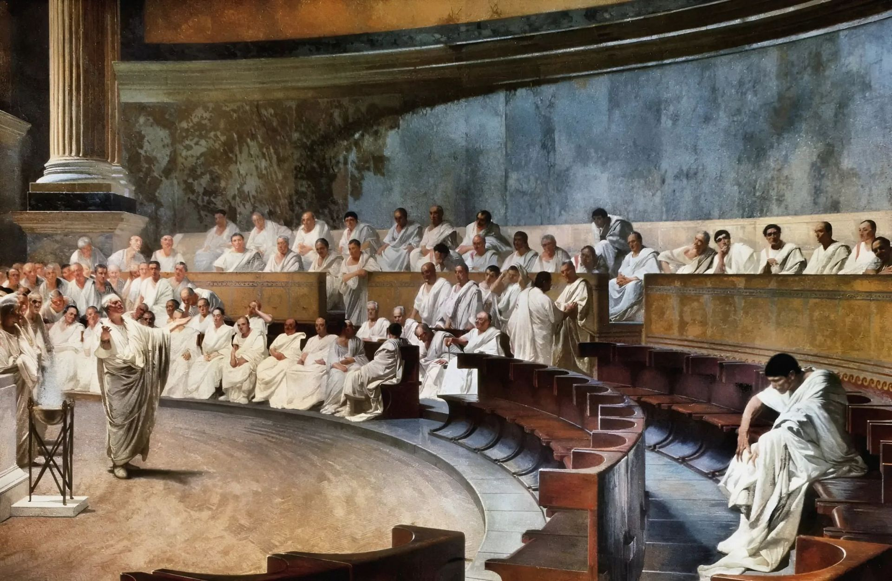
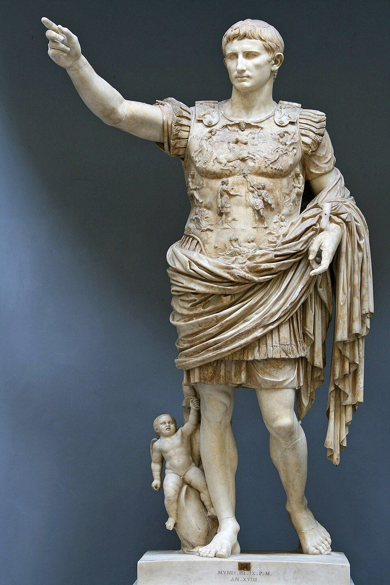
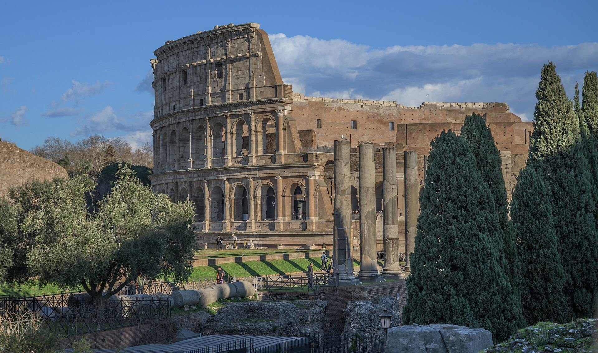
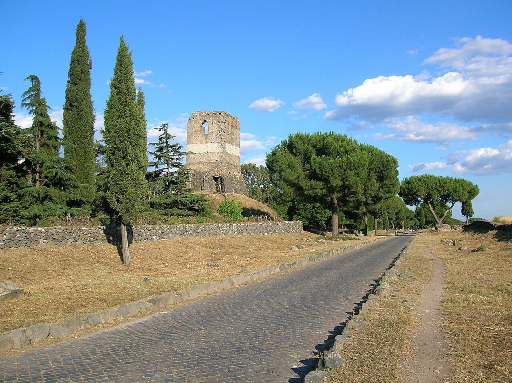
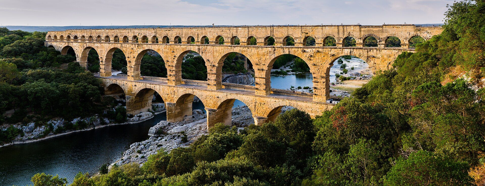
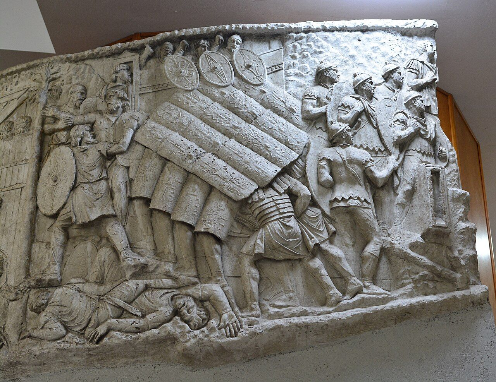

## Ancient Rome: 600 years {#rome-timeline}

::: {.timeline-interactive #rome title="Ancient Rome"}

::: {.event date="509 BC" title="Rome becomes a republic" image="images/roman-senate-maccari.jpg" slide="the-republic"}
The Romans send away their last king. Now citizens choose their leaders.

Two consuls lead Rome, for one year each. The Senate gives them advice. No one can be king again.
:::

::: {.event date="312 BC" title="The Via Appia" image="images/via-appia.jpg"}
The Romans start a long stone road from Rome to the south.

Roads like this one let the army march fast. Many Roman roads are still used today.
:::

::: {.event date="27 BC" title="Augustus, the first emperor" image="images/augustus-prima-porta.jpg" slide="the-first-emperor"}
Augustus takes power. The Republic becomes an empire.

The Senate still meets, but one man now rules Rome, for life.
:::

::: {.event date="About AD 50" title="The Pont du Gard" image="images/pont-du-gard.jpg"}
The Romans build a huge aqueduct bridge in France.

It carried water 50 km to the city of Nîmes. Water flowed down a gentle slope, with no pumps.
:::

::: {.event date="AD 80" title="The Colosseum opens" image="images/colosseum-forum.jpg" slide="the-colosseum"}
A giant arena opens in Rome, for games and shows.

About 50,000 people could watch gladiators and animal hunts.
:::

::: {.event date="AD 113" title="Trajan's Column" image="images/trajans-column-legion.jpg"}
A tall column shows the army's wars, in stone pictures.

The pictures wind around the column like a long story.
:::

:::

::: notes
Press ‹ › to go through the events, tap an event on the line, or drag along the line. Tap the card to zoom in. Three events have their own slides (press ↓ or **Go to this slide**); those slides show a strip with the timeline at the bottom: tap an event there to see it, go to its slide, or come back here.

To make your own: a `::: {.timeline-interactive}` with one `::: {.event date="…" title="…" image="…"}` for each event. The first paragraph is the summary on the card; everything shows when you zoom in. Add `slide="the-slide-id"` to link an event to a slide. Events can be in any order: they're sorted by date ("509 BC", "AD 80", "1453").
:::

## The Republic {#the-republic}

:::: {.columns}
::: {.column width="55%"}
- In 509 BC, Rome sent away its last king.
- Citizens voted for their leaders.
- Two  led Rome, for one year.
- The  gave advice.
:::
::: {.column width="45%"}
{.photo fig-alt="A painting of Roman senators in white togas listening to a speech" style="max-height: 360px"}
:::
::::

## The first emperor {#the-first-emperor}

:::: {.columns}
::: {.column width="60%"}
- In 27 BC, Augustus took power.
- He was the first .
- Rome became an , ruled by one man for life.
- The Senate still met, but it had less power.
:::
::: {.column width="40%"}
{.photo fig-alt="A white marble statue of Augustus with one arm raised" style="max-height: 380px"}
:::
::::

## The Colosseum {#the-colosseum}

:::: {.columns}
::: {.column width="50%"}
- The  opened in AD 80.
- About 50,000 people could watch.
-  fought there.
- It was free to get in!
:::
::: {.column width="50%"}
{.photo fig-alt="The Colosseum, a huge round stone arena, next to the ruins of the Roman Forum" style="max-height: 360px"}
:::
::::

## Put Rome on the timeline

::: {.timeline-activity title="Ancient Rome"}
- 509 BC | Rome becomes a republic 
- 312 BC | The Via Appia 
- 27 BC | Augustus, the first emperor 
- AD 50 | The Pont du Gard 
- AD 80 | The Colosseum opens 
- AD 113 | Trajan's Column 
:::

::: notes
Students drag each event onto the line at its year (or tap it, then tap the line). **Check** marks each one green if it's close enough, or red with its real date and a green dot where it belongs, and says whether the order is right.

To make your own: a `::: {.timeline-activity}` list, one line each: the date, a `|`, the event, and a picture if you like. Or use the same `::: {.event}` divs as the teaching timeline. Options: `tolerance="25"` (how many years off still counts; the usual is 5% of the timeline), `snap="10"` (round to 10 years), `start="600 BC" end="AD 200"`.
:::

## Label the aqueduct

::: {.label-it image="images/pont-du-gard.jpg"}
- Water channel | 40,15 | The water flowed in a covered channel along the very top.
- Small arches | 66,22 | The top row has the smallest arches, under the water channel.
- Big arches | 47,38 | The middle row has big arches, to lift the channel high.
- Bottom arches | 48,57 | The bottom row stands in the river valley.
- River | 12,82 | The aqueduct crosses the Gardon River.
:::

::: notes
Students drag each label onto its numbered dot (or tap a label, then a dot). A right label stays, joined to its dot; a wrong one shakes and shows why.

To make your own: a `::: {.label-it image="…"}` list, one line each: the label, a `|`, where its dot goes, and (after another `|`) a reason. To find where a dot goes, press **L** on the slide and tap the picture: it shows the place as `x,y` (percent from the left and from the top) and copies it.
:::

## Picture credits {.credits}

- **Title and the Colosseum:** photo by Wilfredor, CC0, via Wikimedia Commons.
- ***Cicero Denounces Catiline*:** painting by Cesare Maccari (1889), public domain.
- **Via Appia:** photo by Nicolò Musmeci, public domain. **Augustus of Prima Porta:** photo by Till Niermann, public domain. **Trajan's Column:** photo by Joe Mabel, public domain.
- **Pont du Gard:** photo by Benh LIEU SONG, [CC BY-SA 3.0](https://creativecommons.org/licenses/by-sa/3.0), via Wikimedia Commons.
- Full list: `images/CREDITS.md`.
