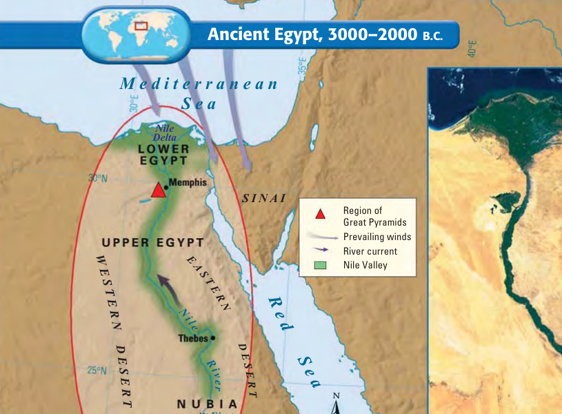
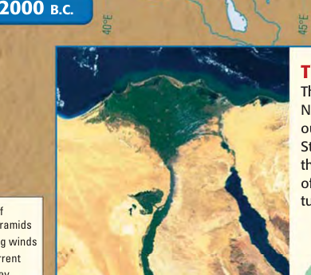
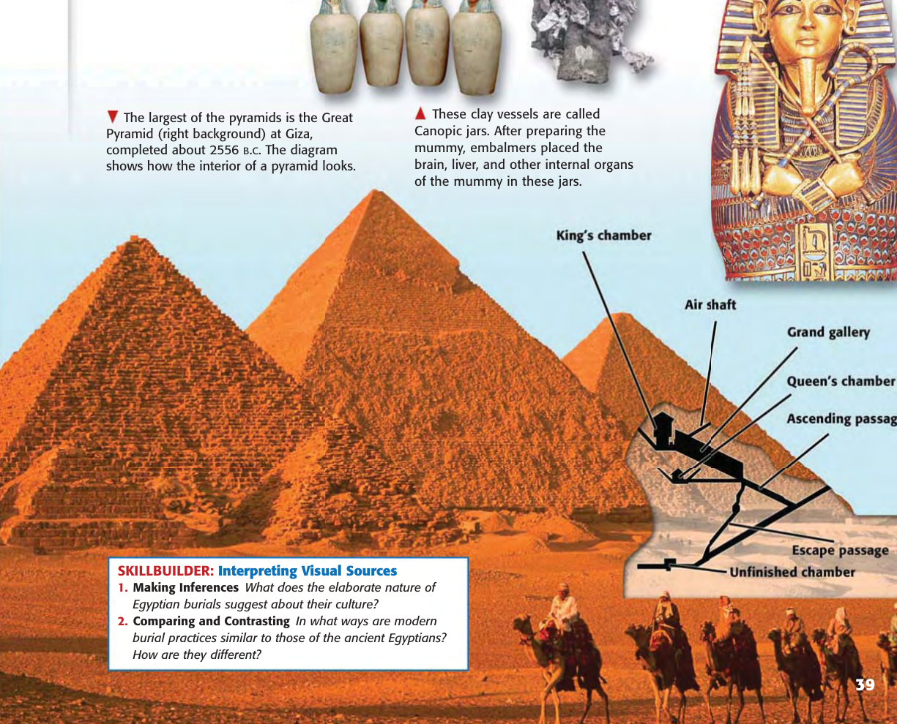
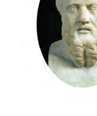
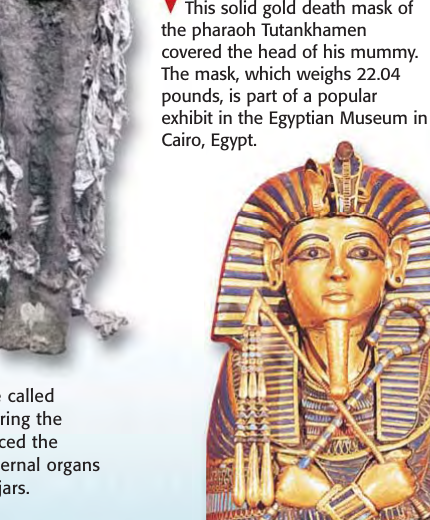
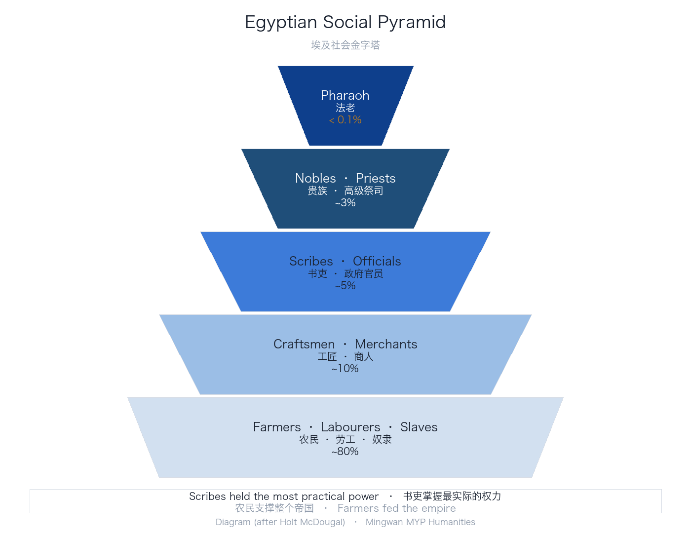
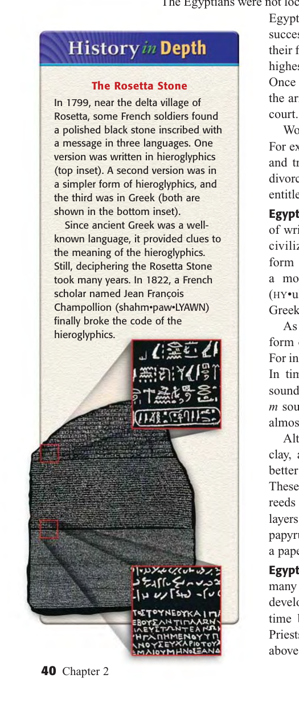

```{python}
import sys; sys.path.append("scripts")
from vocab import load_unit, pick, word_bank
terms = load_unit(1)
```

::: {.callout-note title="Big Question · 本课核心问题" icon=false}
**How did the geography of the Nile — and the Egyptians' belief in life after death — shape one of the ancient world's longest-lasting ?**
*(尼罗河的地理——以及埃及人对来世的信仰——如何塑造了古代世界延续最久的文明之一？)*

- **Main Idea (核心要点 · Science & Technology):** Using math and engineering, Egyptians built magnificent monuments to honor dead rulers.
- **Why It Matters Now (当下意义):** Many of the monuments built by the Egyptians stand today as a testament to their 3,000-year civilization.
:::

```{python}
#| output: asis
print(word_bank({
    "Geography & Unification": pick(terms, "cataract", "delta", "silt", "irrigation", "dynasty"),
    "Religion & Monuments": pick(terms, "pharaoh", "theocracy", "polytheism", "ka", "mummification", "pyramid"),
    "Writing & Legacy": pick(terms, "hieroglyphics", "papyrus", "Rosetta Stone"),
}))
```

### Five Core Knowledge Points · 五个核心知识点

| # | Core Point 核心知识点 | Summary 概要 |
|---|---|---|
| **1** | **The Gift of the Nile (尼罗河的馈赠)** | Predictable July floods + rich black  = a narrow green strip in the desert — the foundation of Egyptian life. |
| **2** | **One Kingdom, One God-King (统一王国与神王)** | Around 3000 B.C. **King Narmer** united Upper and Lower Egypt.  ruled as living gods in a . |
| **3** | **Pyramids & the Afterlife (金字塔与来世)** | Egyptians believed in life after death. Kings built  as eternal tombs for their ; bodies were preserved by . |
| **4** | **A Pyramid of Society (社会金字塔)** | Royal family → upper class → middle class → peasant farmers & laborers. Women could own property and seek divorce. |
| **5** | **Writing, Calendar & Legacy (文字、历法与遗产)** |  on , a 365-day solar calendar, geometry, and medicine — and the  that let scholars read them. |

---

## Section 1 · The Geography of Egypt 第一节：埃及的地理

To the west of the  in Africa, another river makes its way to the sea. While Sumerian civilization was on the rise, a similar process took place along the banks of the **Nile River (尼罗河)** in Egypt. Yet Egyptian civilization turned out to be very different from the collection of  in . Early on, Egypt was united into a single kingdom, which allowed it to enjoy a high degree of unity, stability, and cultural continuity over a period of **3,000 years**.

在非洲肥沃月弯以西，另一条河流同样奔向大海。当苏美尔文明兴起时，类似的进程也发生在尼罗河畔。然而埃及文明最终走上了一条与美索不达米亚城邦截然不同的道路：很早就统一为一个王国，享受了长达 3,000 年的高度统一、稳定与文化连续性。

From the highlands of East Africa to the Mediterranean Sea, the Nile River flows **northward** across Africa for over **4,100 miles**, making it the longest river in the world. Egypt's settlements arose along the Nile on a narrow strip of land made fertile by the river. The change from fertile soil to desert — from the **Black Land (Kemet / 黑土)** to the **Red Land (Deshret / 红土沙漠)** — was so abrupt that a person could stand with one foot in each.

尼罗河自东非高地一路向北流入地中海，全长超过 4,100 英里，是世界上最长的河流。埃及人的聚落沿着尼罗河这条狭长肥沃的河谷兴起。从肥沃的“黑土”到荒凉的沙漠“红土”分界极为分明，甚至一人可一脚踏在两岸不同的土地上。

:::: {.columns}
::: {.column width="48%"}
{width="95%"}
:::
::: {.column width="48%"}
{width="95%"}
:::
::::

### The Gift of the Nile 尼罗河的馈赠

Every year in **July**, rains and melting snow from the mountains of East Africa caused the Nile to rise and spill over its banks. When the river receded in **October**, it left behind a rich deposit of fertile black mud called ****. Before the scorching sun could dry out the soil, peasants prepared their wheat and barley fields and watered their crops all fall and winter from a network of **** ditches. As the ancient Greek historian **Herodotus (希罗多德)** remarked in the fifth century B.C., Egypt was the **"gift of the Nile."**

每年 7 月，东非山区的雨水与融雪让尼罗河上涨漫岸；10 月河水退去后，留下厚厚的黑色淤泥（silt）。整个秋冬，农民依靠灌溉沟渠为小麦与大麦供水。古希腊历史学家希罗多德于公元前 5 世纪赞叹道：埃及是“尼罗河的赠礼”。

### Upper Egypt & Lower Egypt 上埃及与下埃及

Ancient Egyptians lived along the Nile from the Mediterranean mouth south to the point where granite boulders turn the river into churning rapids called a ****. Riverboats could not pass this **First Cataract (第一瀑布)** into the interior of Africa.

古埃及人沿尼罗河生活，但水路交通在巨石急流处中断——称为“第一瀑布”（First Cataract），船只无法通行。

| Upper Egypt (上埃及 · 南方) | Lower Egypt (下埃及 · 北方) |
|---|---|
| • Skinny river valley strip in the **south** | • Broad, marshy **** in the **north** (100 miles before the sea) |
| • **Higher elevation** (upstream toward East Africa) | • **Lower elevation** (downstream at the Mediterranean mouth) |
| • Symbolized by the tall **White Crown (*Hedjet*)** | • Symbolized by the **Red Crown (*Deshret*)** |

::: {.callout-tip title="Geography Skillbuilder & Reading Check A" icon=false}
1. **Movement (流向):** In which direction does the Nile flow, and how did prevailing winds help river travel?
2. **Location (位置):**  the location of Upper Egypt and Lower Egypt.
3. **Main Idea A:**  how the geography of the Nile shaped Egyptian civilization.
:::

---

## Section 2 · Egypt Unites into a Kingdom 第二节：埃及统一为王国

By 3200 B.C., the farming villages of Egypt were under the rule of two separate kingdoms, Lower Egypt and Upper Egypt. Around **3000 B.C.**, **King Narmer (纳尔迈)** united the two kingdoms (though a 1999 rock carving suggests an earlier **King Scorpion / 蝎子王** may have begun unification around 3250 B.C.). A carved slate artifact known as the **Narmer Palette (纳尔迈调色板)** shows Narmer wearing the Red Crown of Lower Egypt on one side and the White Crown of Upper Egypt on the other.

到公元前 3200 年，埃及分为下埃及和上埃及两个王国。约公元前 3000 年，纳尔迈王（King Narmer）完成统一。“纳尔迈调色板”石刻一面展示他头戴下埃及红冠，另一面头戴上埃及白冠。

Narmer created a **Double Crown (红白双冠)** from the red and white crowns, settled his capital at **Memphis (孟菲斯)** near the border where Upper and Lower Egypt met, and established the first of Egypt's **31 **, spanning 2,600 years.

纳尔迈将红白两冠合为“双冠”，在上下埃及交界处建立都城孟菲斯，开启了延续 2,600 年的 31 个王朝。

### Pharaohs Rule as Gods & Builders of the Pyramids 法老即神与金字塔建造者

In Mesopotamia, kings were considered representatives of the gods. In Egypt, kings *were* gods. The Egyptian god-kings, called ****, stood at the center of Egypt's religion, government, and army. This type of government in which rule is based on religious authority is called a ****. Egyptians believed the pharaoh caused the sun to rise, the Nile to flood, and the crops to grow.

在美索不达米亚，国王被视为神的代表；而在埃及，被称为“法老”（pharaoh）的国王本身就是神。这种以宗教权威为基础的统治称为“神权政治”（theocracy）。埃及人相信是法老让太阳升起、尼罗河泛滥、庄稼生长。

Egyptians also believed that their king ruled even after his death through his eternal life force, or ****. Since kings expected to reign forever, their tombs were even more important than their palaces. For the kings of the **Old Kingdom (古王国, c. 2660–2180 B.C.)**, the eternal resting place was an immense stone structure called a ****.

埃及人相信国王死后其永恒的生命力“卡”（ka）仍在统治，因此陵墓比宫殿更重要。古王国时期是建造金字塔（pyramid）的鼎盛时代。

---

## Section 3 & 4 · Egyptian Religion, Pyramids & Mummies 第三、四节：宗教、金字塔与木乃伊

Unlike the Sumerians, the Egyptians had a rich supply of granite and limestone. For the **Great Pyramid of Giza (吉萨大金字塔, completed c. 2556 B.C.)**, more than **2 million stone blocks** weighing **2.5 to 15 tons each** were stacked without wheels to a height of **481 feet** across **13 acres**. Peasant laborers built the pyramids during the Nile flood season when they could not farm, receiving food and housing from the state and carving their team nicknames (*"the Vigorous Gang," "the Enduring Gang"*) into the stones.

以吉萨大金字塔（约公元前 2556 年建成）为例，两百多万块重达 2.5 至 15 吨的巨石被堆叠至 481 英尺高，占地 13 英亩。建造者并非奴隶，而是在尼罗河泛滥期为国家劳作并获得食宿的农民，他们还在石块上刻下“活力队”“耐久队”等班组名称。

{width="75%"}

### Religion, the Weighing of the Heart & Mummification 宗教、称心审判与木乃伊

Like the Mesopotamians, Egyptians were ****, worshipping over 2,000 gods and goddesses — including **Re (太阳神拉)**, **Osiris (冥神奥西里斯)**, **Isis (母亲女神伊西斯)**, and **Anubis (亡灵引路神阿努比斯)**. In contrast to the bleak Mesopotamian underworld, Egyptians believed in a hopeful afterlife:

- **The Weighing of the Heart (称心仪式):** When a person died, **Anubis** weighed their heart against the **Feather of Truth (Ma'at)**. If the heart was **lighter than the feather**, the soul lived forever in the beautiful **Other World (彼岸世界)**. If it was heavy with sin, the fierce **Devourer of Souls (吞魂兽)** gobbled it up.
- ** (木乃伊制作):** Royal and elite bodies were preserved by embalming and drying so the soul () could return to its body, accompanied by treasures, canopic jars, and scrolls of the ***Book of the Dead* (《亡灵书》)**.

:::: {.columns}
::: {.column width="45%"}
{height="200px"}
:::
::: {.column width="55%"}
{height="200px"}
:::
::::

::: {.callout-important title="Primary Source · Herodotus on Mummification (《历史》第二卷)" icon=false}
*"First, they draw out the brains through the nostrils with an iron hook… Then with a sharp stone they make an incision in the side, and take out all the bowels… Then, having filled the belly with pure myrrh, cassia, and other perfumes, they sew it up again; and when they have done this they steep it in **natron** [a mineral salt], leaving it under for **70 days**… At the end of 70 days, they wash the corpse, and wrap the whole body in bandages of waxen cloth."* — **Herodotus**, *The Histories*
:::

---

## Section 5, 6 & 7 · Society, Writing, Science & Invaders 第五至七节：社会、文字、科技与外族入侵

:::: {.columns}
::: {.column width="42%"}
{width="95%"}
:::
::: {.column width="58%"}
### Life in Egyptian Society 埃及社会生活
- **Top:** King (), queen, and royal family.
- **Upper Class:** Wealthy landowners, government officials, priests, and army commanders.
- **Middle Class:** Merchants and artisans.
- **Lower Class (Largest):** Peasant farmers and laborers (plus enslaved war captives in later periods).
- **Social Mobility & Women:** Egyptians could rise in status by learning to read and write. Egyptian women could **own and trade property**, **propose marriage**, and **seek divorce** (receiving **one-third** of the couple's property).
:::
::::

### Egyptian Writing & the Rosetta Stone 象形文字与罗塞塔石碑

:::: {.columns}
::: {.column width="38%"}
{width="90%"}
:::
::: {.column width="62%"}
Egyptian scribes developed **** (*"sacred carvings"*), in which pictures stood for both ideas and sounds, and wrote them on sheets of **** made from pressed delta reeds.

In **1799**, French soldiers near Rosetta found a black stone inscribed with a royal decree in **three scripts**: **hieroglyphics**, **demotic** (simple everyday script), and **ancient Greek**. Because scholars knew ancient Greek, French scholar **Jean-François Champollion (商博良)** deciphered hieroglyphics in **1822**.
:::
::::

### Science, Technology & the Hyksos Invasion 科学技术与喜克索斯人入侵

- **365-Day Solar Calendar (365天太阳历):** Priests tracked the rising of the star **Sirius** before the annual flood to divide the year into **12 months of 30 days + 5 holiday days** (only 6 hours short of the true solar year).
- **Mathematics & Geometry (数学与几何):** Written numbers for tax collection and geometry to reset farm boundaries after annual floods and engineer stone columns and pyramids.
- **Medicine (医学):** Doctors checked the pulse for heart rate, set broken bones with splints, treated fevers/wounds, and performed surgery.
- **Rise & Fall of Kingdoms (王朝兴衰):** After the Old Kingdom declined around 2180 B.C., the **Middle Kingdom (2040–1640 B.C.)** dug a canal from the Nile to the Red Sea and drained delta swamps for farmland. Around **1640 B.C.**, West Asian invaders called the **Hyksos (喜克索斯人, *"rulers of foreign lands"*)** conquered Egypt and ruled from **1630 to 1523 B.C.**, before Egypt rose again in the **New Kingdom**.

---

## Section 8 · Section Assessment Questions 课后评估练习

1. **Terms & Names:** Write one sentence explaining the historical significance of each: `delta`, `Narmer`, `pharaoh`, `theocracy`, `pyramid`, `mummification`, `hieroglyphics`, `papyrus`.
2. **Using Your Notes:** Which of the Egyptian achievements do you consider the most important? .
3. **Main Idea (Geography):** How did being surrounded by deserts benefit Egypt?
4. **Main Idea (Government):** How did the Egyptians view the ?
5. **Main Idea (Religion):** Why did Egyptians mummify bodies?
6. **Drawing Conclusions:** Which of the natural features that served as boundaries in ancient Egypt (deserts, , Mediterranean & Red Seas) was most important to Egypt's history? Explain.
7. **Comparing & Contrasting:** How were Sumerian  and Egyptian  similar, and how were they different?

::: {.content-visible when-profile="teacher"}
---

## Teacher Answer Key · 教师参考答案

1. **Terms & Names:** See Unit 1 Vocabulary bank at the top of this page.
2. **Most Important Achievement:** Any well-reasoned choice (e.g., the **365-day solar calendar** because it regulated agriculture and forms the basis of our modern calendar; ** & ** because lightweight scrolls enabled administration across a 3,000-year kingdom; or **geometry/stone engineering**).
3. **Desert Benefit:** The vast Sahara and Eastern deserts acted as natural defensive barriers that blocked frequent foreign invasions, allowing Egypt to develop in stability and peace compared to the open plains of Mesopotamia.
4. **View of Pharaoh:** Egyptians viewed the  not merely as a representative of the gods, but as a **living god on earth** who caused the sun to rise, the Nile to flood, and the crops to grow, uniting religion and government in a ****.
5. **Why Mummify:** Egyptians believed the soul/life-force (****) needed to recognize and return to a preserved physical body in order to enjoy eternal life in the Other World.
6. **Natural Boundaries:** The surrounding **deserts** were most critical for preventing east-west land invasions, while the **First ** blocked river invasions from the south.
7. **Cuneiform vs. Hieroglyphics:** **Similarities:** Both began as pictographs representing objects/ideas, evolved to represent sounds, and were written by trained scribes to record taxes, laws, and religion. **Differences:** Cuneiform used wedge-shaped marks pressed into heavy wet clay tablets with a reed stylus, whereas hieroglyphics used detailed picture-symbols carved on stone walls or written with ink on lightweight **** reed paper.
:::
