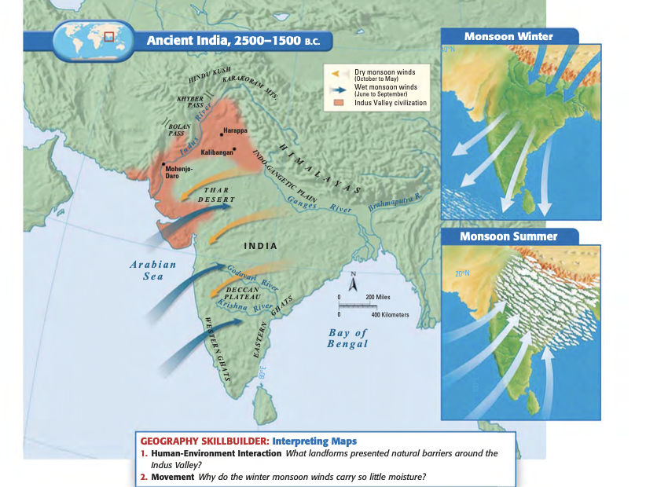
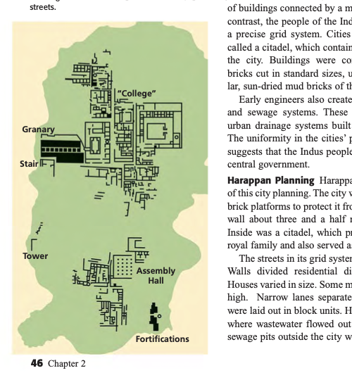
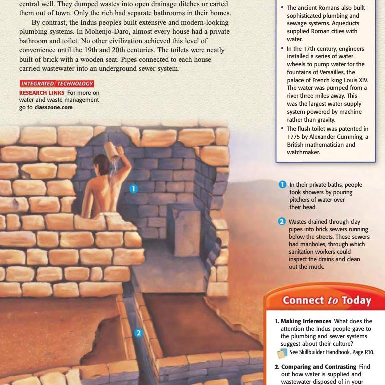
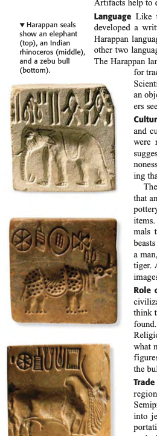

```{python}
import sys; sys.path.append("scripts")
from vocab import load_unit, pick, card_grid
terms = load_unit(1)
```

## Planned Cities on the Indus 印度河流域的规划城市

**MYP Humanities · Grade 7 & 8 · Chapter 2 Lesson 4**

- **Period 1:** Geography, Monsoons, Planned Cities, Harappan Culture & Decline (4 stages · 50 min)

## Lesson Flow 本课流程

| Stage | Time | Focus |
|---|---|---|
| **Stage 1 · Warm-up 导入** | 5 min | WU1–WU3 · Recall & predict |
| **Stage 2 · Direct Instruction 讲授** | 15 min | Geography, monsoons, Harappan cities |
| **Stage 3 · Learning Activity 学习活动** | 20 min | FA1–FA5 · Map, monsoon, planning, plumbing, seals |
| **Stage 4 · Exit Ticket 当堂检测** | 5 min | ET1 · Three short questions |

## Stage 1 · Warm-up 导入 (5 min)

Answer in your Learning Sheet (WU1–WU3 · MYP Criterion A):

1. **WU1 · Recall 回顾:** In , why did people live near rivers?
   - 在美索不达米亚，人们为什么住在河流附近？
2. **WU2 · Predict 预测:** The Indian  has the world's highest mountains in the north. How might mountains affect life there?
   - 印度次大陆北部有世界最高的山脉。山脉可能如何影响那里的生活？
3. **WU3 · Observe 观察:** Find the Indus and Ganges on the map. Which sea or bay does each river flow into?
   - 在地图上找到印度河与恒河。它们分别流入哪个海或湾？

::: {.callout-tip}
### Do 指令
1. Write 1–2 sentences for each question. 每题写 1–2 句。
2. Turn & talk with your partner — 30 seconds. 与同桌讨论，30 秒。
3. Keep WU2 — we will return to it later. 保留 WU2，稍后回来验证。
:::

## The Geography of the Indian Subcontinent 印度次大陆的地理

:::: {.columns}
::: {.column width="55%"}
- **The Indian  (印度次大陆):**
  - Includes modern India, Pakistan, and Bangladesh (包括印度、巴基斯坦和孟加拉国).
  - Separated from the rest of Asia by the **Himalayas**, **Hindu Kush**, and **Karakorum** mountain ranges (被喜马拉雅山、兴都库什山和喀喇昆仑山与亚洲隔开).
- ** (印度-恒河平原):** Flat and fertile plain formed by the Indus and Ganges rivers (平坦肥沃).
- **Deccan Plateau (德干高原):** Dry southern highland bordered by the Eastern and Western Ghats (干燥，被东高止山和西高止山环绕).
:::
::: {.column width="45%"}
{width="100%" fig-alt="Map of Ancient India and Monsoon Winds"}
:::
::::

## Monsoons and Environmental Challenges 季风与环境挑战

- ** (季风)** are seasonal winds that dominate India's climate (主导印度气候的季节性风).
- **Winter monsoons (Oct–Feb):** Blow dry air from the northeast (冬季季风从东北带来干燥空气).
- **Summer monsoons (Jun–Oct):** Carry moisture from the ocean, causing heavy rain and floods (夏季季风从海洋带来水汽，引发洪水).
- **Environmental Challenges:**
  - Yearly floods spread rich , but Indus floods were unpredictable.
  - Rivers sometimes changed course.
  - Too little rain = **drought** (干旱); too much = **crop disasters** (作物灾害).

::: {.callout-note}
### Connect to Today 联系当下
Modern India still depends on monsoon rains. A weak or late monsoon can damage crops and affect the whole region's economy. (现代印度仍依赖季风降雨。季风偏弱或迟到会损害作物，影响整个地区的经济。)
:::

## Civilization Emerges on the Indus 印度河流域文明的兴起

:::: {.columns}
::: {.column width="58%"}
- Historians know less about the Indus Valley because its writing has **not been deciphered** (由于印度河文字尚未破译，历史学家对它了解较少).
- By **3200 B.C.**, farming villages lined the Indus River (印度河沿岸已布满村落).
- Around **2500 B.C.**, planned cities such as **Harappa** and **Mohenjo-Daro (摩亨佐-达罗)** were built on human-made islands and behind strong earthen levees (哈拉帕和摩亨佐-达罗等规划城市建成).
- The **** had more than 100 settlements across modern Pakistan and India (拥有 100 多个定居点).
:::
::: {.column width="42%"}
{width="100%" fig-alt="Plan of the Citadel at Mohenjo-Daro"}
:::
::::

## Planned Cities and Plumbing 规划城市与排水系统

:::: {.columns}
::: {.column width="55%"}
- ** (网格系统):** Streets crossed at precise right angles (街道以直角相交).
- ** (城堡):** A fortified area containing major public buildings, a granary, and the Great Bath (包含主要建筑的防御区域).
- **Standard oven-baked bricks** across many cities (多座城市使用标准烘烧砖).
- **Advanced plumbing (先进排水系统):** Private bathrooms, brick-lined sewers under the streets, and manholes for maintenance (私人浴室、砖砌下水道、检修孔).

> **Think 思考:** What does the uniformity of bricks, streets, and drains suggest about Harappan government? (砖块、街道和排水系统的统一性对哈拉帕政府说明了什么？)
:::
::: {.column width="45%"}
{width="95%" fig-alt="Plumbing in Mohenjo-Daro"}
:::
::::

## Harappan Culture and Decline 哈拉帕文化与衰落

:::: {.columns}
::: {.column width="58%"}
- **Language:** About 400 symbols on stone stamps — still undeciphered (约 400 个符号，尚未破译).
- **Religion:** Links to later Hindu culture — early Shiva figure, mother goddess, and bull worship (与后世印度教文化相关——湿婆、母神、公牛).
- **Trade:** Gold from Afghanistan, cotton cloth, and **** found in Sumer (黄金来自阿富汗、棉布、苏美尔发现的印章).
- **Decline around 1750–1500 B.C.:**
  - Possible causes: tectonic shifts causing earthquakes, floods, and river changes (Saraswati River drying up), soil exhaustion, and **Aryan (雅利安人)** migration (地震、洪水、河流改道、土壤耗竭、雅利安人迁入).
:::
::: {.column width="42%"}
{width="75%" fig-alt="Harappan Seals: elephant, Indian rhinoceros, zebu bull"}

{width="55%" fig-alt="Bearded Figure / Priest-King"}
:::
::::

::: notes
Harappan seals show an elephant (top), an Indian rhinoceros (middle), and a zebu bull (bottom).
:::

## FA1 & FA2 · Map Labeling & Interpreting Monsoons

:::: {.columns}
::: {.column width="50%"}
### FA1 · Map Labeling 地图标注 (Criterion A)
Label on your Learning Sheet:

1. Himalayas (喜马拉雅山脉)
2. Indus River (印度河)
3. Ganges River (恒河)
4. Arabian Sea (阿拉伯海)
5. Bay of Bengal (孟加拉湾)
6. Deccan Plateau (德干高原)
:::
::: {.column width="50%"}
### FA2 · Interpreting Monsoons 季风解读 (Criterion B)
Answer on your sheet:

- **a)** From which direction do winter  blow? What weather do they bring?
  *(冬季季风从哪个方向吹来？带来什么天气？)*
- **b)** What problems do farmers face if the summer monsoon is too strong or too weak?
  *(夏季季风过强或过弱会给农民带来什么麻烦？)*
:::
::::

## FA3 · Compare City Planning 城市规划比较 (Criterion D)

| Feature 特征 | Harappan Cities 哈拉帕城市 | Mesopotamian Cities 美索不达米亚城市 |
|---|---|---|
| **Streets 街道** |  (直角网格街道) | Winding, irregular streets (弯曲杂乱的街道) |
| **Bricks 砖块** | Standard oven-baked bricks (标准烘烧砖) | Irregular sun-dried mud bricks (不规则日晒泥砖) |
| **Public Center 中心建筑** | Fortified  & Great Bath (防御城堡与大浴场) | Walled city & central  (城墙与中央金字形神塔) |
| **Sanitation 排水设施** | Private bathrooms & underground brick sewers (私人浴室与地下砖砌下水道) | Open drainage ditches (露天排水沟) |

- **Conclusion 结论:** *The most striking feature of Harappan planning was \_\_\_\_\_\_\_\_\_\_.* (哈拉帕规划最突出的特点是 \_\_\_\_\_\_\_\_。)

## FA4 & FA5 · Plumbing Inference & Seal Analysis

:::: {.columns}
::: {.column width="50%"}
### FA4 · Inference from Plumbing (Criterion C)
**Evidence 证据:**

- Almost every house had a private bathroom and toilet (几乎每座房屋都有私人浴室和厕所).
- Brick sewers ran under the streets (砖砌下水道铺在街道下).
- Manholes allowed workers to clean the drains (检修孔供工人清理).

**Question:** What does this evidence tell us about Harappan society? (这一证据告诉我们关于哈拉帕社会的什么信息？)
:::
::: {.column width="50%"}
### FA5 · Analyze a Harappan Seal (Criterion D)
- **a)** What meanings might the animals on  have? (动物可能有什么意义？)
- **b)** Why has Harappan writing not been deciphered? (为什么哈拉帕文字尚未破译？)

**Sentence Frames 句式支架:**

- *These animals probably represented \_\_\_\_\_ because \_\_\_\_\_.*
- *Harappan writing has not been deciphered because \_\_\_\_\_.*
:::
::::

## Stage 4 · Exit Ticket 当堂检测 (5 min · Criterion A)

Answer independently on your Learning Sheet (在学习单上独立作答):

1. **ET1-a:** What natural features both protected and limited farming in the Indian ?
   - 哪些自然地理特征既保护了印度次大陆，又限制了农耕？
2. **ET1-b:** What is most surprising about Harappan city planning? Use evidence.
   - 哈拉帕城市规划中哪一点最让你惊讶？用证据说明。
3. **ET1-c:** What was the most likely cause of the decline of the Indus Valley ?
   - 印度河流域文明衰落最可能的原因是什么？

## Vocabulary Review · Indus Valley

```{python}
#| output: asis
print(card_grid(pick(terms,
    "subcontinent", "monsoon", "Harappan civilization",
    "Indo-Gangetic Plain", "citadel", "grid system", "Harappan seals"
)))
```
