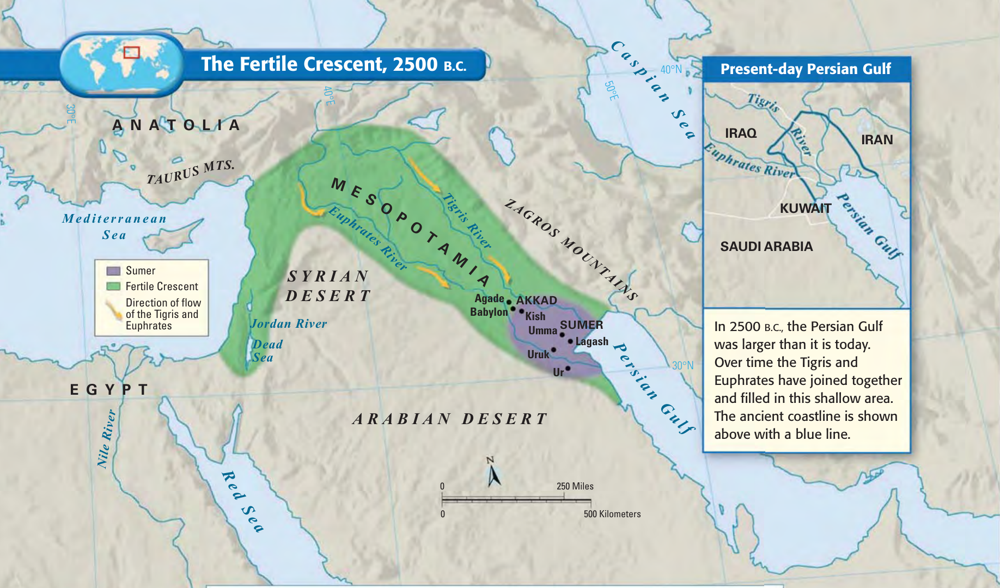
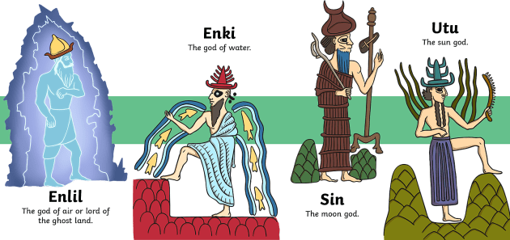
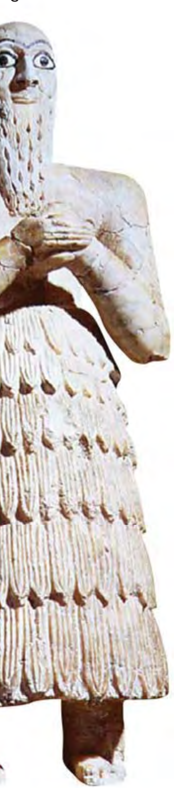
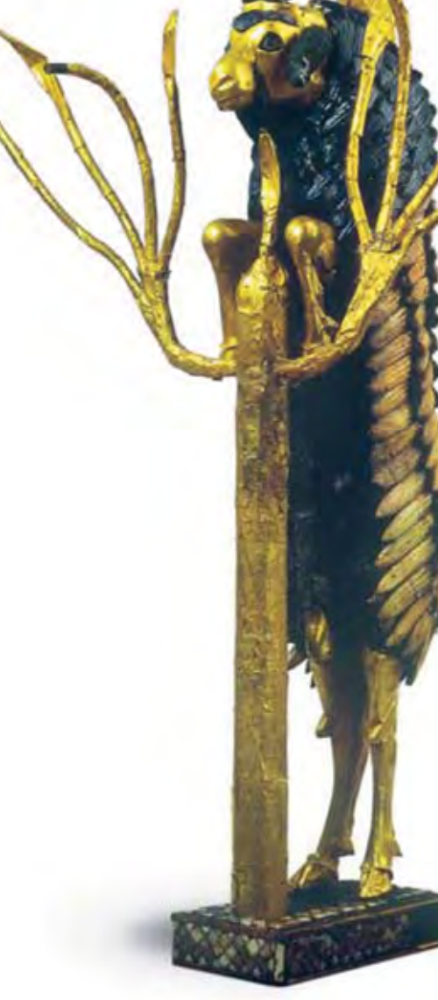
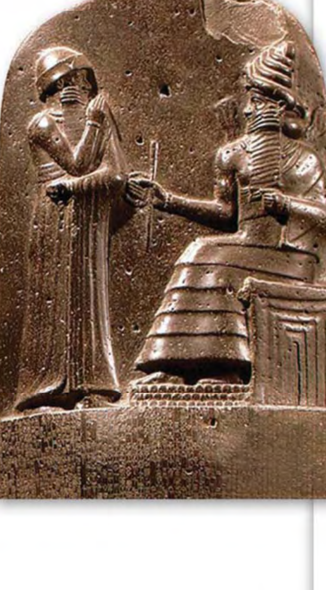

```{python}
import sys; sys.path.append("scripts")
from vocab import load_unit, pick, word_bank
terms = load_unit(1)
```

::: {.callout-note title="Inquiry Question · 课前探究问题" icon=false}
**Why did  emerge between two unpredictable rivers?**
*(为什么城邦会诞生在两条不安分的河流之间？)*

- **Main Idea (核心要点 · Interaction with Environment):** The earliest  in Asia arose in  and organized into independent .
- **Why It Matters Now (当下意义):** People living along a great river organize farms, build cities, invent new technologies, and form governments — transforming a fragile environment into a lasting civilization.
:::

```{python}
#| output: asis
print(word_bank({
    "Geography & Farming": pick(terms, "Fertile Crescent", "Mesopotamia", "silt", "irrigation", "surplus", "division of labour"),
    "Society, Religion & Law": pick(terms, "city-state", "dynasty", "cultural diffusion", "polytheism", "ziggurat", "cuneiform", "empire", "Code of Hammurabi"),
}))
```

---

## 1. Geography of the Fertile Crescent 肥沃月弯的地理

Two rivers flow from the mountains of what is now Turkey, down through Syria and Iraq, and finally to the Persian Gulf. Over six thousand years ago, the waters of these rivers provided the lifeblood that allowed the formation of farming settlements. These grew into villages and then cities.

两条河流发源于今土耳其境内的山脉，穿过叙利亚和伊拉克，最终汇入波斯湾。六千多年前，这两条河的水源提供了农业定居赖以生存的命脉。定居点逐渐发展为村庄，再发展为城市。

A desert climate dominates the landscape between the Persian Gulf and the Mediterranean Sea in Southwest Asia. Yet within this dry region lies an arc of land that provided some of the best farming in Southwest Asia. The region's curved shape and the richness of its land led scholars to call it the ****. It includes the lands facing the Mediterranean Sea and a plain that became known as ****. The word in Greek means *"land between the rivers."*

在波斯湾与地中海之间的西南亚地区，沙漠性气候占主导。然而就在这片干旱区域中，存在着一片弧形土地——它提供了西南亚最优良的农业条件。该地区弯曲的形状与肥沃的土壤使学者们称之为“肥沃月弯”（Fertile Crescent）。它包括地中海东岸的狭长地带与一块内陆平原，这块平原后来被称为 Mesopotamia（美索不达米亚）。该词源自希腊语，意为“两河之间的土地”。

The rivers framing Mesopotamia are the **Tigris (底格里斯河)** and **Euphrates (幼发拉底河)**. They flow southeastward to the Persian Gulf. The Tigris and Euphrates rivers flooded Mesopotamia at least once a year. As the floodwater receded, it left a thick bed of mud called ****. Farmers planted grain in this rich, new soil and irrigated the fields with river water. The results were large quantities of wheat and barley at harvest time. The **** from their harvests allowed villages to grow.

界定美索不达米亚的两条河是底格里斯河与幼发拉底河。它们向东南流入波斯湾。这两条河每年至少泛滥一次。当洪水退去，便留下一层厚厚的淤泥（silt）。农民在这种肥沃的新土中播种谷物，并用河水灌溉田地。结果是收获季节获得大量的小麦与大麦。粮食的盈余使村庄得以扩张。

{width="85%"}

::: {.callout-tip title="Geography Skillbuilder · 地图阅读" icon=false}
1. **Location (定位):**  where the Tigris and Euphrates River valleys are found. *(Tigris 和 Euphrates 河谷位于何处？)*
2. **Place (地方):** What is the most likely cause of the change in the Persian Gulf coastline since 2500 B.C.? *(波斯湾海岸线变化的最可能原因是什么？)*
:::

### Environmental Challenges 环境挑战

People first began to settle and farm the flat, swampy lands in southern Mesopotamia before 4500 B.C. Around 3300 B.C., the people called the **Sumerians (苏美尔人)** arrived on the scene. Good soil was the advantage that attracted these settlers. However, there were **three disadvantages** to their new environment:

公元前 4500 年之前，人们已开始在南美索不达米亚的平坦沼泽地带定居并耕作。约公元前 3300 年，被称为苏美尔人的族群登上了这片土地的舞台。肥沃的土壤是吸引这些定居者的优势，但他们面对的新环境也有三大不利之处：

1. **Unpredictable flooding combined with drought (洪水难料且干旱频繁):** After the flood receded, the sun baked the ground rock-hard with little or no rain.
2. **No natural barriers for protection (缺乏天然防御屏障):** Standing on an open plain, a Sumerian village was nearly defenseless against invaders.
3. **Limited natural resources (自然资源匮乏):** Building materials like stone, timber, and metal were scarce.

### Solving Problems Through Organization 通过组织解决问题

Over a long period of time, the people of Sumer created solutions to deal with these problems:

- To provide water, they dug **** ditches that carried river water to their fields and allowed them to produce a **** of crops. *(为提供水源，他们挖掘灌溉水渠，将河水引入田地，使其产出余粮。)*
- For defense, they built city walls with sun-dried **mud bricks**. *(为防御，他们用泥砖修建城墙。)*
- Sumerians **traded** their grain, cloth, and crafted tools with the peoples of the mountains and the desert. In exchange, they received raw materials such as stone, wood, and metal. *(苏美尔人用谷物、布匹与精致工具与山地、沙漠地区的人们交换，获得石头、木材与金属等原材料。)*

These activities required **organization, cooperation, and leadership**. It took many people working together to construct large irrigation systems. Leaders were needed to plan the projects and supervise the digging. These projects also created a need for **laws** to settle disputes over how land and water would be distributed. These leaders and laws were the beginning of organized government — and eventually of .

这些活动需要组织、合作与领导。例如修建大型灌溉系统需要许多人协作；规划工程与监督挖掘需要领袖。这些工程也催生了对法律的需求，以解决土地与水源分配的纠纷。这些领袖与法律，就是有组织政府的开端——也是文明的开端。

---

## 2. Sumerians Create City-States 苏美尔人建立城邦

The Sumerians stand out in history as one of the first groups of people to form a . Five key characteristics set Sumer apart from earlier human societies: **(1) advanced cities, (2) specialized workers (), (3) complex institutions, (4) record keeping, and (5) improved technology**.

苏美尔人在历史上是第一批形成文明的人类群体之一。使苏美尔区别于更早期人类社会的五个关键特征是：(1) 发达的城市；(2) 专业的劳动者（社会分工）；(3) 复杂的制度；(4) 文字记录；(5) 改良的技术。

By 3000 B.C., the Sumerians had built a number of cities, each surrounded by fields of barley and wheat. Although these cities shared the same culture, they developed their own governments, each with its own rulers. Each city and the surrounding land it controlled formed a ****. A city-state functioned much as an independent country does today. Sumerian city-states included **Uruk (乌鲁克), Kish (基什), Lagash (拉加什), Umma (乌玛), and Ur (乌尔)**. At the center of all Sumerian cities was the walled temple with a **** in the middle.

到公元前 3000 年，苏美尔人已建造了许多城市，每座都被大麦与小麦的农田环绕。尽管这些城市共享同一种文化，它们各自形成了独立的政府，各有自己的统治者。每一座城市与其所控制的周边土地构成一个“城邦”（city-state）。所有苏美尔城市的中心都是带围墙的神庙，中间矗立一座塔庙（ziggurat）。

{width="65%"}

### Priests, Rulers, and Dynasties 祭司、统治者与王朝

Sumer's earliest governments were controlled by the temple priests. Farmers believed that the success of their crops depended upon the blessings of the gods, and priests acted as go-betweens with the gods. In addition to being a place of worship, the  was like a city hall from which priests managed the irrigation system and collected grain taxes.

苏美尔最早的政府由神庙祭司控制。除了作为礼拜场所，塔庙还具有市政厅的功能：祭司从塔庙管理灌溉系统，并向每位农民索取收成的一部分作为税赋。

In time of war, however, the men of the city chose a tough fighter to command the city's soldiers. After 3000 B.C., wars between cities became more and more frequent, and commanders were given permanent control of standing armies. In time, military leaders became full-time kings who passed their power on to their sons. Such a series of rulers from a single family is called a ****.

在战争时期，市民们推选勇猛战将指挥军队。公元前 3000 年以后，城邦间战争日益频繁，军事领袖逐渐成为全职国王，并把权力传给儿子。同一家族连续执政的统治者系列称为“王朝”（dynasty）。

### The Spread of Cities & Cultural Diffusion 城市的扩展与文化传播

By 2500 B.C., prosperous trade allowed new cities to arise across the Fertile Crescent in Syria, northern Iraq, and Turkey. Sumerians exchanged products and ideas with neighboring cultures. This process in which a new idea or product spreads from one culture to another is called ****.

到公元前 2500 年，繁荣的贸易使新城市在整片肥沃月弯不断涌现。新的观念或产品从一种文化传播到另一种文化的过程被称为“文化传播”（cultural diffusion）。

---

## 3. Sumerian Culture, Religion, and Technology 苏美尔文化、宗教与科技

### A Religion of Many Gods 多神信仰

Like many peoples in the Fertile Crescent, the Sumerians believed that many different gods controlled the various forces in nature. The belief in more than one god is called ****. **Enlil (恩利尔)**, the god of storms and air, was among the most powerful gods; Sumerians feared him as *"the raging flood that has no rival."*

苏美尔人相信自然界中的各种力量分别由不同的神灵掌控，这种多神信仰称为 polytheism。风暴与空气之神恩利尔（Enlil）被称为“无与伦比的狂怒洪水”。

Because their environment was harsh and unpredictable, Sumerians believed their gods were immortal, all-powerful, and easily angered. Humans were merely their servants. Even after death, Sumerians expected little help: they believed dead souls went to the **"land of no return" (不归之地)**, a gloomy underworld where *"dust is their fare and clay their food."* Some of the richest accounts of Mesopotamian myths appear in the ***Epic of Gilgamesh* (《吉尔伽美什史诗》)**.

苏美尔人在现世努力劳作以求神灵庇护，但相信死后灵魂会去阴暗凄凉的“不归之地”：“尘土是他们的食物，黏土是他们的饮食。”

### Life in Sumerian Society 苏美尔的社会生活

With civilization came social classes:

1. **Highest Level (最高阶层):** Kings, landlords, and high priests.
2. **Upper-Middle Level (次高阶层):** Wealthy merchants.
3. **Majority Working Class (普通劳动阶层):** Farmers and artisans working in fields and workshops.
4. **Lowest Level (最底层):** Enslaved people (foreign war captives or Sumerian debt slaves who could hope to eventually buy their freedom).

**Sumerian Women:** Women could work as merchants, farmers, or artisans, hold property in their own names, and join the priesthood. Though few women were scribes, Sumerian women had more legal rights than women in many later civilizations.

:::: {.columns}
::: {.column width="48%"}
{height="220px"}
:::
::: {.column width="48%"}
{height="220px"}
:::
::::

### Sumerian Science and Technology 苏美尔的科技

Sumerians invented the **wheel (车轮)**, the **sail (帆)**, and the **plow (犁)**, and were among the first to use **bronze (青铜)**:

- **Arithmetic and Geometry (算术与几何):** Developed a **base-60 (60进制)** number system to survey flooded fields and plan canals, giving us the **60-second minute** and the **360-degree circle**.
- **Architecture (建筑创新):** Invented arches, columns, ramps, and tiered  pyramids.
- ** (楔形文字):** Wedge-shaped writing pressed into wet clay tablets to record maps, taxes, astronomy, chemistry, medicine, and laws.

---

## 4. The First Empire Builders & Hammurabi's Code 最早的帝国缔造者与《汉谟拉比法典》

### Sargon of Akkad 阿卡德的萨尔贡

From 3000 to 2000 B.C., constant warfare weakened Sumer's city-states. Around **2350 B.C.**, a conqueror named **Sargon (萨尔贡)** from **Akkad** defeated the Sumerian city-states and united northern and southern Mesopotamia into the world's first **** — bringing several peoples, nations, or previously independent states under the control of one ruler.

约公元前 2350 年，来自阿卡德的征服者萨尔贡击败苏美尔各城邦，控制了南北美索不达米亚，建立了世界上第一个帝国（empire）——将若干民族、国家或原本独立的政体置于同一统治者治下。

### Babylonian Empire & Hammurabi's Code 巴比伦帝国与《汉谟拉比法典》

Around 2000 B.C., nomadic warriors called **Amorites (阿摩利人)** invaded Mesopotamia and established their capital at **Babylon (巴比伦)** on the Euphrates River. The Babylonian Empire reached its peak during the reign of **Hammurabi (汉谟拉比, 1792–1750 B.C.)**, who compiled **282 laws** into the **** and had them carved on black stone steles placed throughout his empire.

约公元前 2000 年，阿摩利人在幼发拉底河畔建立巴比伦。巴比伦帝国在汉谟拉比统治时期（公元前 1792–1750 年）达到鼎盛。他将 282 条法律汇集成《汉谟拉比法典》，刻在黑色玄武岩石柱上竖立于帝国全境。

:::: {.columns}
::: {.column width="38%"}
{width="90%"}
:::
::: {.column width="62%"}
::: {.callout-important title="Primary Source · Excerpts from the Code of Hammurabi" icon=false}
**Prologue (序言):** *"To bring about the rule of righteousness in the land, to destroy the wicked and the evil-doers; **so that the strong should not harm the weak**."* *(“使公平正大之道立于大地，以灭邪恶之徒，使强者不得欺凌弱者。”)*

- **§8:** If a man has stolen an ox, sheep, pig, or boat from a **temple or palace**, he shall repay **30 times** its cost; if from a **private citizen**, **10 times**. If the thief cannot pay, he shall be **put to death**. *(盗神庙或王宫财物赔30倍，盗私人赔10倍，无力赔偿处死。)*
- **§53:** If a man is too lazy to make his ** dam** strong and it breaks and floods his neighbors' farmland, he shall be sold for silver to replace the ruined grain. *(怠于加固水坝导致决堤淹毁邻田者，卖身赔偿谷物。)*
- **§142:** If a blameless wife is neglected by her husband, she shall be held innocent and may return to her father's house. *(妻子贞洁无过而遭夫虐待，判无罪可回娘家。)*
- **§143:** If the woman is at fault and neglects her house, she shall be **thrown into the river**. *(若妻子败德有过，投入河中淹死。)*
- **§196:** If a man put out the eye of another **free nobleman**, his eye shall be put out. *(若自由贵族损毁另一贵族之眼，以眼还眼。)*
- **§198:** If he puts out the eye of a **freed man (commoner)**, he shall pay **one gold mina**. *(若损毁平民之眼，赔偿一黄金弥那。)*
- **§199:** If he puts out the eye of a **man's slave**, he shall pay **one-half of its value**. *(若损毁他人奴隶之眼，赔偿奴隶价值的一半。)*
:::
:::
::::

---

## 5. Reading Check & Source Analysis Activities 阅读检测与史料分析

1. **Reading Check A ():** What were the three solutions to the environmental challenges of Mesopotamia?
2. **Reading Check B ( Causes):** How did military leaders gain permanent power in the Sumerian city-states?
3. **Reading Check C (Contrasting):** How does an  differ from a ?
4. **Source Analysis Q1 (Making Inferences):** Why might the punishments for the same crime in Hammurabi's Code (e.g., `§8` or `§196–199`) be based on social class?
5. **Source Analysis Q2 (Recognizing Effects):** What does this set of laws tell us about Babylonian society's values?  at least three values you can infer from the laws.
6. **Source Analysis Q3 (Forming Opinions):** What was the value in carving these punishments on stone pillars in public places for all to see?

::: {.content-visible when-profile="teacher"}
---

## Teacher Answer Key & Instructional Notes (教师参考答案与教学指导)

- **Map Skillbuilder Q1 (Location):** The Tigris and Euphrates valleys run northwest-to-southeast through present-day Iraq, between the Syrian Desert to the west and the Zagros Mountains to the east, emptying into the Persian Gulf.
- **Map Skillbuilder Q2 (Place):** Over thousands of years, the Tigris and Euphrates rivers have carried and deposited enormous amounts of  at their mouths, gradually filling in the northern end of the Persian Gulf and pushing the coastline further south.
- **Reading Check A:** (1) Dug  ditches and canals to bring water to fields; (2) Built mud-brick city walls for defense; (3) Traded surplus grain, cloth, and tools with mountain and desert peoples for stone, wood, and metal.
- **Reading Check B:** As wars between city-states became more frequent after 3000 B.C., temporary military commanders were given permanent control of standing armies, eventually becoming full-time kings who passed power to their sons in .
- **Reading Check C:** A  is a single independent city and its surrounding farmland under one local government, whereas an  brings together many different peoples, nations, or previously independent states under a single ruler.
- **Source Analysis Q1:** Class-based punishments show that Babylonian society was strictly stratified. Noblemen, commoners, and enslaved people were not equal before the law; the law protected elite property and status above all else.
- **Source Analysis Q2:** Key values include: (1) strict social hierarchy; (2) protection of temple, royal, and private property (`§8`); (3) collective responsibility for irrigation infrastructure (`§53`); (4) patriarchal family order (`§142–143`); (5) principle of retaliation (*lex talionis*, `§196`); and (6) divine authority of the king.
- **Source Analysis Q3:** Publicly displaying the stone stele (a) deterred crime, (b) ensured officials could not change laws arbitrarily, (c) reinforced Hammurabi's claim to divine justice from Shamash, and (d) replaced private blood feuds with state law.
:::
